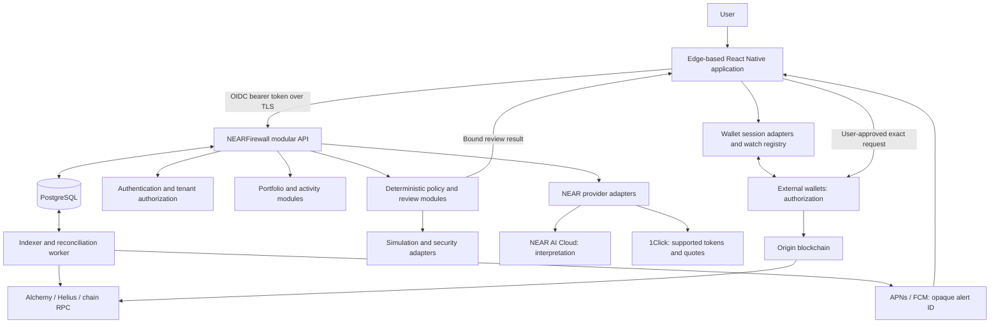
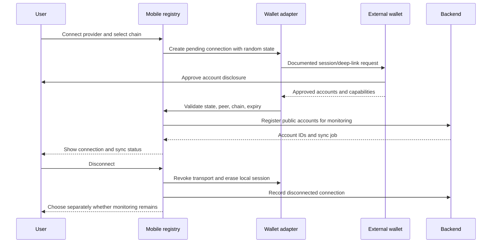
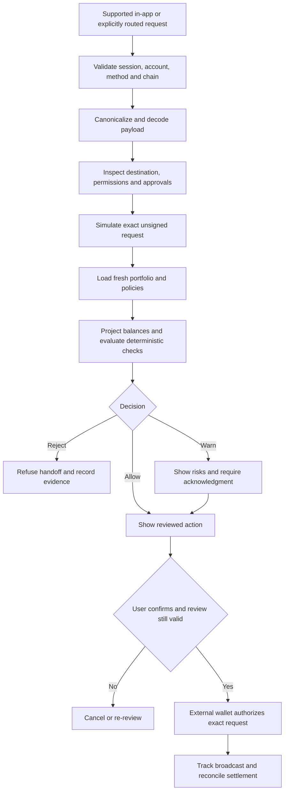
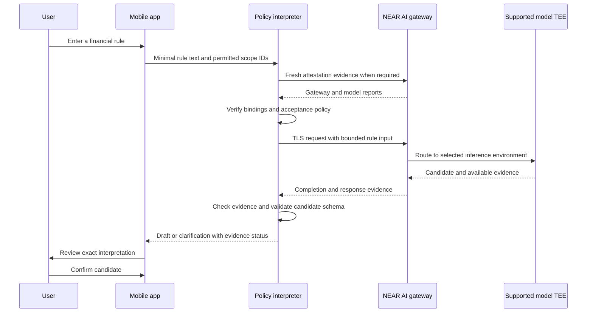
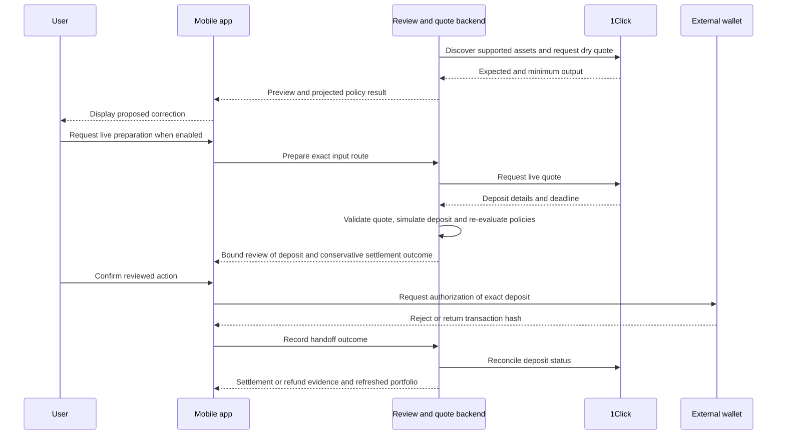
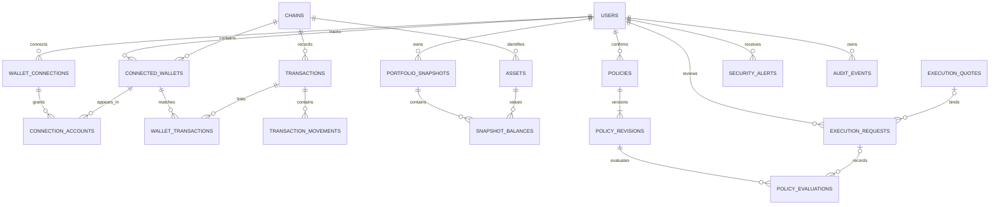

# NEARFirewall

**One application. Every wallet. One financial firewall.**

Master engineering and implementation specification · Research date: **11 November 2026**

> **Repository status:** this initial repository contains the implementation specification and configuration template. The mobile application, backend, integrations, and commands marked **proposed** have not been implemented here. The selected mobile foundation is [Edge React GUI](https://github.com/EdgeApp/edge-react-gui); importing and validating that foundation is Phase 0. Nothing in this README certifies a working integration or a completed security audit.

## 1. Project overview

NEARFirewall is a non-custodial mobile application for understanding and protecting a portfolio spread across external wallets. It connects supported wallets, monitors public addresses, combines balances and activity, and evaluates supported signing requests against financial rules confirmed by the user.

The application targets Android and iOS using the existing Edge React Native and TypeScript project. Funds remain in external wallets. NEARFirewall never requests their seed phrases or private keys. Connection permission, application authentication, and transaction authorization are separate operations.

NEAR contributes two core capabilities: NEAR AI Cloud interprets natural-language rules through a privacy-aware inference integration, and NEAR Intents supplies corrective cross-chain quotes. Optional, explicitly authorized execution follows the same deterministic firewall as every other controlled request.

Throughout this document:

| Label | Meaning |
| --- | --- |
| **Verified upstream** | Inspected in the Edge Git source at the immutable revision below |
| **Documented provider capability** | Described by official documentation or a package manifest; not device-tested in this repository |
| **Proposed** | A NEARFirewall design, type, endpoint, file, or implementation requirement |
| **Future** | Outside the essential hackathon delivery |
| **Verification gate** | Evidence still required before enabling a capability |

All unqualified NEARFirewall requirements below are **proposed**, not claims of existing code.

## 2. Problem statement

Wallet users must repeatedly open separate applications to inspect balances, transactions, approvals, and exposure. A legitimate swap can also undermine a personal financial objective without triggering conventional scam detection.

For example, a user can hold 24% stablecoins across Ethereum, Base, and Solana, then propose a swap that lowers that allocation to 14%. The contract can be legitimate while the transaction violates the user's confirmed 20% minimum. NEARFirewall needs both consolidated financial data and a pre-signing review opportunity to detect that conflict before the wallet authorizes it.

Mobile operating systems isolate applications. NEARFirewall cannot intercept arbitrary signing activity inside unrelated wallets. Activity outside supported integrations is observable only to the extent that on-chain data providers expose it, usually after broadcast or settlement.

## 3. Product vision

Give users one coherent view of linked public accounts and a financial policy layer for supported actions. The first release must be understandable when data is incomplete: show coverage, price age, provider failures, and the exact scope of protection.

| Capability | What it means | What it authorizes |
| --- | --- | --- |
| Read-only wallet monitoring | Query public accounts and holdings | No signing or proof of ownership |
| Transaction monitoring | Index activity and issue evidence-based alerts | No ability to reverse or block it |
| Pre-signing inspection | Review a request routed through an implemented integration | Permission to analyze only |
| Actual blocking | Refuse to forward a rejected request in a controlled flow | Local enforcement within that flow |
| User-approved execution | Ask the selected external wallet to authorize the reviewed payload | Only that payload, subject to wallet consent |

Use visible badges such as `Monitoring only`, `Review available in this app`, `Disconnected`, and `Data incomplete`. Never display an unqualified “all wallets protected” badge.

## 4. Core features

| Area | Initial delivery | Expansion |
| --- | --- | --- |
| Wallets | Multiple external connections; independent manual watch accounts; connection lifecycle | Additional provider adapters and Cardano signing |
| Portfolio | Ethereum, Base, and Solana liquid holdings; asset identity; USD subtotal and coverage | DeFi positions, debt, staking, and additional chains |
| Activity | Normalized transfers, decoded swaps where supported, fees, failures, filters | Rich approval inventory and protocol decoding |
| Rules | User-confirmed allocation, concentration, slippage, recipient, and spending policies | Protocol-specific health factor policies |
| Firewall | At least one real routed EVM review flow; allow/warn/reject; immutable review evidence | Selected third-party dApp integrations and wallet-native extensions |
| NEAR AI | Rule interpretation with schema validation and privacy disclosure | Attestation-bound client E2EE after compatibility validation |
| NEAR Intents | Live supported-token discovery and dry quote | Explicitly approved deposit execution and settlement tracking |
| Alerts | Activity, stale coverage, and policy violations | Advanced anomaly detection |

## 5. Why NEARFirewall is different

Transaction safety includes the user's financial constraints. A transaction can pass contract reputation checks and still exceed a daily spending limit, concentrate an asset, or consume a stablecoin reserve.

NEARFirewall combines policy interpretation, deterministic evaluation, simulation evidence, and consolidated balances. AI proposes and explains rules; it does not calculate authoritative decisions, change thresholds silently, or override hard constraints. Suggestions are independently evaluated before the wallet is asked to sign.

The tagline describes the product direction. Actual wallet, chain, indexing, simulation, and signing coverage must be stated separately and measured in the running application.

## 6. Existing repository and customization strategy

### 6.1 Inspected baseline and reproducibility

**Verified upstream:** Edge's remote default branch was `develop` at inspection. The source examined was:

```text
Repository: https://github.com/EdgeApp/edge-react-gui
Branch:     develop
Commit:     5f6e7611984434afee66804ffadfe765c11fd235
Commit date: 2026-11-09
App version: 4.53.0
```

Source files were read directly from this Git revision, including files unavailable to a normal Windows checkout. This was a source inspection; dependency installation, native compilation, and upstream test execution were not performed. Do not substitute values from `master`, cached repository pages, or an unpinned latest branch.

Immutable evidence links:

| Evidence | Source |
| --- | --- |
| Versions, dependencies, and npm scripts | [package.json](https://github.com/EdgeApp/edge-react-gui/blob/5f6e7611984434afee66804ffadfe765c11fd235/package.json), [package-lock.json](https://github.com/EdgeApp/edge-react-gui/blob/5f6e7611984434afee66804ffadfe765c11fd235/package-lock.json) |
| Application root and providers | [App.tsx](https://github.com/EdgeApp/edge-react-gui/blob/5f6e7611984434afee66804ffadfe765c11fd235/src/components/App.tsx), [Providers.tsx](https://github.com/EdgeApp/edge-react-gui/blob/5f6e7611984434afee66804ffadfe765c11fd235/src/components/services/Providers.tsx) |
| Navigation and route typing | [Main.tsx](https://github.com/EdgeApp/edge-react-gui/blob/5f6e7611984434afee66804ffadfe765c11fd235/src/components/Main.tsx), [routerTypes.tsx](https://github.com/EdgeApp/edge-react-gui/blob/5f6e7611984434afee66804ffadfe765c11fd235/src/types/routerTypes.tsx) |
| Core and blockchain registration | [EdgeCoreManager.tsx](https://github.com/EdgeApp/edge-react-gui/blob/5f6e7611984434afee66804ffadfe765c11fd235/src/components/services/EdgeCoreManager.tsx), [corePlugins.ts](https://github.com/EdgeApp/edge-react-gui/blob/5f6e7611984434afee66804ffadfe765c11fd235/src/util/corePlugins.ts) |
| WalletConnect role and request handling | [WalletConnectService.tsx](https://github.com/EdgeApp/edge-react-gui/blob/5f6e7611984434afee66804ffadfe765c11fd235/src/components/services/WalletConnectService.tsx), [useWalletConnect.tsx](https://github.com/EdgeApp/edge-react-gui/blob/5f6e7611984434afee66804ffadfe765c11fd235/src/hooks/useWalletConnect.tsx) |
| Wallet balances and transaction streaming | [useWalletBalance.ts](https://github.com/EdgeApp/edge-react-gui/blob/5f6e7611984434afee66804ffadfe765c11fd235/src/hooks/useWalletBalance.ts), [useTransactionList.ts](https://github.com/EdgeApp/edge-react-gui/blob/5f6e7611984434afee66804ffadfe765c11fd235/src/hooks/useTransactionList.ts) |
| Persistence and state | [walletConnectSessionStore.ts](https://github.com/EdgeApp/edge-react-gui/blob/5f6e7611984434afee66804ffadfe765c11fd235/src/util/walletConnectSessionStore.ts), [RootReducer.ts](https://github.com/EdgeApp/edge-react-gui/blob/5f6e7611984434afee66804ffadfe765c11fd235/src/reducers/RootReducer.ts) |
| Native platform requirements | [android/build.gradle](https://github.com/EdgeApp/edge-react-gui/blob/5f6e7611984434afee66804ffadfe765c11fd235/android/build.gradle), [gradle.properties](https://github.com/EdgeApp/edge-react-gui/blob/5f6e7611984434afee66804ffadfe765c11fd235/android/gradle.properties), [Podfile](https://github.com/EdgeApp/edge-react-gui/blob/5f6e7611984434afee66804ffadfe765c11fd235/ios/Podfile) |
| Preparation and test configuration | [prepare.sh](https://github.com/EdgeApp/edge-react-gui/blob/5f6e7611984434afee66804ffadfe765c11fd235/scripts/prepare.sh), [jest.config.js](https://github.com/EdgeApp/edge-react-gui/blob/5f6e7611984434afee66804ffadfe765c11fd235/jest.config.js), [AGENTS.md](https://github.com/EdgeApp/edge-react-gui/blob/5f6e7611984434afee66804ffadfe765c11fd235/AGENTS.md) |

### 6.2 Verified architecture inventory

| Area | Observed implementation | Consequence for NEARFirewall |
| --- | --- | --- |
| Framework | React Native **0.86.0**, React **19.2.3**, TypeScript `~5.8.3` (lock: **5.8.3**), Expo `^57.0.7` (lock: **57.0.7**) | Preserve native project and version pairing; do not start a new Expo template |
| Package management | npm lockfile; `packageManager: npm@11.15.0`; root Node engine `>=18` | Use npm; dependency engines are stricter than the root declaration |
| React Native Node engine | Lockfile allows `^20.19.4`, `^22.13.0`, `^24.3.0`, or `>=25.0.0`; upstream Jenkins selects Node 22 | Start with a patched Node 22 release satisfying `>=22.13.0`; record exact version in Phase 0 |
| Build | Metro, Babel, native Gradle and CocoaPods, Rollup-built bridge shims, TypeChain for ethers v5 | Retain preparation steps and existing polyfills |
| Navigation | `Main.tsx` creates root/app stacks, bottom tabs, a drawer, and feature stacks using React Navigation 6 packages | Modify typed route definitions and existing shell |
| Scenes | `HomeScene.tsx`, `WalletListScene.tsx`, `TransactionListScene.tsx`, `TransactionDetailsScene.tsx`, `SettingsScene.tsx`, `LoginScene.tsx`, send/swap/approval modals | Reuse presentation primitives while replacing assumptions about `EdgeCurrencyWallet` |
| Wallet engine | `EdgeCoreManager` mounts `edge-core-js` using a WebView and plugin native I/O; core lock version **2.55.0** | External accounts must have their own registry; a connected public address is not an Edge signing wallet |
| Blockchain plugins | Currency and exchange plugin packages; `corePlugins.ts` lists Ethereum, Base, Solana, Cardano and many other IDs | Registration is not evidence of external-wallet integration or enabled support |
| WalletConnect | `@walletconnect/web3wallet` **1.10.1** in lock; service initializes wallet-side handling; hook approves sessions for Edge wallets | It is not the external-wallet dApp connector needed by NEARFirewall |
| History | `useTransactionList` streams per-wallet/per-token Edge transactions, handles changed/removed events and pagination | Reuse list UX; external normalized history requires a new source |
| Balances/prices | `useWalletBalance` subscribes to `balanceMap`; `util/exchangeRates.ts` batches Edge rate queries | Reuse formatting; external token identity and valuation must be explicit |
| Authentication | `LoginScene` uses `LoginScreen` from `edge-login-ui-rn`; `Providers` mounts `LoginUiProvider` | Useful baseline, but creates a dependency on Edge account/context semantics |
| Storage | `makeReactNativeDisklet()` in providers; account-local disklets for settings/session maps; AsyncStorage dependency | Disklet or AsyncStorage alone does not prove OS-backed secure storage |
| State | Redux 4, React Redux 8, thunk, `RootReducer`, additional state providers; TanStack Query 5 in app root | Keep existing state approach; Query owns remote cache, Redux owns app/session UI |
| APIs/backend | Edge core/plugin and information/rates services; development logging scripts; no NEARFirewall server/database | Add a focused backend; the logging server is not a product backend |
| Native Android | min SDK **28**, compile/target **36**, build tools **36.1.0**, NDK **27.1.12297006**, Kotlin **2.3.20**, Gradle wrapper **9.3.1**, new architecture/Hermes enabled | Preserve initial settings; record a compatible build JDK in Phase 0 |
| Native iOS | iOS **16.4** minimum in Podfile, static frameworks, Expo autolinking, Fabric/Hermes, permission setup | Preserve React/Hermes source-build pairing and Podfile workarounds |
| Native dependencies | Firebase messaging, Sentry, Vision Camera, device info, permissions, native chain modules and native API signer | Audit permissions and remove unused features only after baseline builds |
| UI | ThemeContext, theme variables/config, common layout components, themed controls, text and list components, Airship modals | Extend established components instead of adding another UI framework |
| Tests/CI | Jest 29.7, React Native Testing Library, MSW/snapshots, Maestro directories and scripts, GitHub checks and Jenkinsfile | Extend meaningful tests and replace inherited credentials/deployment targets |

Secure-storage implementation inside transitive Edge core/login packages was **not audited**. Retain those packages for baseline compatibility; do not claim they already supply an application-token vault. Add an explicitly validated Keychain/Keystore-backed wrapper for new credentials.

### 6.3 Component reuse matrix

| Existing component | Decision | Reason and adaptation |
| --- | --- | --- |
| Navigation | Modify | Keep React Navigation and route typing; expose five product tabs |
| Wallet engine | Retain selectively | Keep baseline operational; do not import external seeds or construct fake signing wallets |
| WalletConnect | Evaluate and adapt | Reuse lifecycle/error concepts; add external-wallet client role; any future relay needs two explicit roles |
| Asset screens/cards | Modify | Consume normalized external accounts and coverage-aware totals |
| Transaction history | Modify | Preserve list/detail UX; supply a multi-account backend feed |
| Secure storage | Retain audited pieces; add wrapper | Existing account storage and SDK sessions need separate protection reviews |
| Wallet onboarding | Modify | App account plus external connections and watch addresses; remove seed import from product routes |
| Authentication | Adapt | Reuse Edge account login during baseline; add first-party OIDC application authentication for external-wallet product flows |
| State and query cache | Reuse | Add focused slices/query keys; no competing global state library |
| Theme, buttons, layout, modals | Reuse | NEARFirewall colors/content/accessibility using established primitives |
| Native projects and build scripts | Reuse | Preserve functioning native integrations and bridge preparation |
| Edge swap/ramp/earn flows | Hide initially | They depend on Edge custody/signing semantics and are outside the MVP |
| Branding | Replace | New app identity, icons, package identifiers, deep links, domains, and store assets |
| Marketing/analytics defaults | Modify | Disable collection of financial metadata and obtain appropriate user preferences |

### 6.4 Import strategy

Create a dedicated integration branch from NEARFirewall `main`; add Edge as an `upstream` remote, fetch the pinned revision, and merge its history with `--allow-unrelated-histories`. Resolve README and ignore-file conflicts by preserving this specification and the union of required exclusions. Preserve upstream history, license, notices, patches, and native files. Commit the working baseline before feature changes. This is a future Phase 0 operation, not performed by this documentation bootstrap.

Do not silently upgrade React Native, change package managers, rewrite navigation, or replace the Edge starter. Record upstream updates and dependency changes with exact revisions and native build evidence.

## 7. Complete application architecture

Use a **modular TypeScript backend**, one PostgreSQL database, and one worker process built from the same backend package. Use PostgreSQL-backed jobs/outbox initially. Introduce Redis or independently deployed services only after measured need.

| Boundary | Responsibilities | Explicit exclusions |
| --- | --- | --- |
| Mobile | UI, external-wallet sessions, public-account selection, local cache, user review, wallet handoff | Provider secrets; external private keys; autonomous rule changes |
| Shared domain package | Schemas, canonical asset IDs, policy AST, decimal arithmetic, deterministic evaluator, request fingerprints | Network calls, UI, or model inference |
| Backend API | OIDC token verification, user authorization, wallet registry, review creation, policy versioning, quote proxy | Holding external signing keys or asserting ownership of watch accounts |
| Worker | Backfill, continuous indexing, balance/price refresh, reconciliation, policy monitoring, alert delivery | Signing or automatic corrective spending |
| Provider adapters | RPC/indexers, simulation/security services, NEAR inference and 1Click | Bypassing domain validation |
| External wallet | Account disclosure and final transaction/message authorization | Guaranteeing that NEARFirewall reviews activity outside its flow |

**Source of truth:** finalized chain evidence for settlement; PostgreSQL for confirmed policies and review records; wallet SDK for live session capabilities. Caches never silently become authoritative. Mobile evaluation can provide immediate UI feedback; only a fresh server review can authorize a controlled handoff.

Threat boundaries include the mobile OS, third-party wallet, backend, indexers, simulation provider, AI gateway/model environments, and the Intents execution route. Authenticate and validate every crossing independently.

## 8. System architecture diagram



The backend has no signing-key arrow. An LLM response cannot directly invoke an execution adapter.

## 9. Mobile application structure

### 9.1 Five primary sections

| Tab | Required information/actions |
| --- | --- |
| Home / Portfolio | Total known USD value and coverage; count of unique accounts; allocation and chain distribution; approved-stablecoin share; concentration; security coverage; active warnings/rule violations; recent activity |
| Wallets | Provider, public account, network, value/unknown state, connection capability, last successful sync, connect/disconnect, add watch address, remove monitoring separately |
| Activity | Hash, source account, chain, asset(s), type, amount(s), fee, historical USD if known, timestamp, status, destination, decoder/evidence details; wallet/chain/direction/type/date/status filters |
| Firewall | Enabled state per controlled flow; confirmed rules; alerts; pending reviews; simulation evidence; advisory/hard outcomes; refusal history; alternatives; supported emergency actions |
| Settings | Connections, notification/privacy/AI preferences, NEAR health, app authentication, device security, sync controls, data export/deletion, attribution and app version |

Every scene needs loading, empty, partial-data, disconnected, offline, retry, and accessibility states. Activity labels distinguish `Observed after broadcast`, `Reviewed before wallet handoff`, `Refused by NEARFirewall`, and `Rejected by wallet`. Disabling advisory monitoring does not retroactively cancel a signed transaction.

### 9.2 Proposed additions inside the Edge layout

Paths below are **new design targets**, not inspected upstream files. Root mobile structure stays intact.

```text
src/
  components/scenes/nearFirewall/
    PortfolioScene.tsx
    ExternalWalletsScene.tsx
    UnifiedActivityScene.tsx
    FirewallScene.tsx
    PolicyEditorScene.tsx
    TransactionReviewScene.tsx
    CorrectiveActionScene.tsx
    FirewallSettingsScene.tsx
    AppOnboardingScene.tsx
  services/nearFirewall/
    apiClient.ts
    connectionRegistry.ts
    secureSessionStore.ts
    reviewCoordinator.ts
    deepLinkRouter.ts
    adapters/{manual,reown,metamask,phantom}.ts
  hooks/nearFirewall/
    usePortfolio.ts
    useUnifiedActivity.ts
    useFirewallReview.ts
  reducers/nearFirewallReducer.ts
packages/domain/src/
  assets.ts
  portfolio.ts
  transactions.ts
  policies.ts
  evaluate.ts
  reviewFingerprint.ts
  schemas.ts
backend/
  src/{auth,wallets,portfolio,indexing,policies,reviews,near,notifications,audit}/
  src/{server,worker}.ts
  migrations/
  openapi.yaml
  package.json
```

Create the domain package with compiled exports consumable by Metro and the server; validate Metro watching/resolution before adding npm workspace configuration. Keep backend dependencies out of the mobile bundle. UI strings go through the existing localization system; themes go through `ThemeContext` and existing theme files.

## 10. External wallet integrations

### 10.1 Integration decisions and capability matrix

**Documented capability is not validated compatibility.** Persist session-granted namespaces, chains, methods, account IDs, expiry, and connection identity. Derive buttons from those grants, not the wallet's brand.

| Provider/transport | Platform and documented scope | Initial decision | Gate before signing |
| --- | --- | --- | --- |
| Reown AppKit React Native | App-side external-wallet connectivity; EVM, Solana and Bitcoin adapters documented | Primary EVM multi-wallet candidate; add only required chains | Two-wallet coexistence/restoration, React Native 0.86/Fabric build, method grants, expiry and rejection tests |
| MetaMask | Original `metamask-sdk` repository is deprecated; successor MetaMask Connect documents React Native EVM integration | Connect through Reown when supported; direct Connect adapter as a tested alternative | Merge required shims into existing Metro config; verify account/chain events and approved methods |
| MetaMask Snaps | [Wallet extension mechanism](https://docs.metamask.io/snaps/) with permission and host constraints | Future transaction-insight research | Confirm supported wallet/platform and whether insights can enforce anything; do not claim generic mobile interception |
| Phantom | Official mobile universal links support Solana on iOS/Android | Solana connection path, with signing as a later capability if device-tested | Encrypted sessions, callback binding, supported transaction versions, URL size and sign/send semantics |
| Solana Mobile Wallet Adapter | Android native-module wallet transport; React Native tooling documented | Optional Android adapter | Compatible wallet installed, native build, reauthorization, versioned-transaction support; no assumed iOS parity |
| VESPR / Cardano | CIP-30 describes a web wallet bridge; VESPR publishes a Dart/Flutter WalletConnect transport | Manual Cardano monitoring first; signing future | Demonstrate current VESPR mobile dApp transport and namespace interoperability in RN; a Flutter package is not a RN SDK |
| Shield | Name does not uniquely identify a wallet or official developer interface | Unsupported until exact product/domain is identified; manual public monitoring if chain supported | Obtain official documentation and prove transport; no invented Shield SDK |
| Manual watch address | Public RPC/indexer queries only | First-class MVP path | Chain-aware validation and clear absence of ownership/signing permission |

Sources: [Reown installation](https://docs.reown.com/appkit/react-native/core/installation), [deprecated MetaMask SDK](https://github.com/MetaMask/metamask-sdk), [MetaMask RN quickstart](https://docs.metamask.io/metamask-connect/evm/quickstart/react-native/), [Phantom mobile links](https://docs.phantom.com/phantom-deeplinks/deeplinks-ios-and-android), [Solana Mobile RN installation](https://docs.solanamobile.com/get-started/react-native/installation), [CIP-30](https://cips.cardano.org/cip/CIP-0030), [VESPR transport](https://github.com/vespr-wallet/wallet_connect_cardano).

Phantom's current official mobile URL format is `https://phantom.com/ul/<version>/<method>`; its documentation instructs migrating older `phantom.app` links. Use documented methods and response formats, not a fabricated generic signing API. For MWA, the current guide presents `@wallet-ui/react-native-kit` and `@wallet-ui/react-native-web3js`; do not paste its new-Expo-project setup over Edge's native configuration.

### 10.2 Package verification snapshot

The npm registry reported these versions on the research date:

| Package | Observed version | Relevant manifest constraint | Status |
| --- | --- | --- | --- |
| `@reown/appkit-react-native` | **2.0.6** | React `>=18`, RN `>=0.72`, SVG `>=13.10`, safe area `>=4.4`, WC utils/compat `>=2.16.1` | Candidate; native/runtime compatibility untested |
| `@reown/appkit-ethers-react-native` | **2.0.6** | React `>=18`, RN `>=0.72`, random values `>=1.11`, netinfo `>=11`, WC compat `>=2.16.1` | Candidate; inspect dependency graph against Edge ethers 5 |
| `@metamask/connect-evm` | **2.1.1** | Node `>=20.19.0` | Optional candidate; not installed |

Registry evidence: [AppKit manifest](https://registry.npmjs.org/@reown%2Fappkit-react-native/2.0.6), [Ethers adapter manifest](https://registry.npmjs.org/@reown%2Fappkit-ethers-react-native/2.0.6), [MetaMask manifest](https://registry.npmjs.org/@metamask%2Fconnect-evm/2.1.1). Version numbers are research observations, not an instruction to bypass peer resolution. Pin accepted packages with `--save-exact` and commit the lockfile after both native builds pass. Reuse existing dependencies where compatible; do not replace Edge's ethers major globally.

### 10.3 Proposed adapter contracts

Separate connection/signing transport from chain data. Most wallets do not provide historical balances or complete transaction history over their connection protocol.

```typescript
type ChainId = string // validated CAIP-2 or registered internal chain key
type AccountId = string // chain + canonical public address

interface WalletCapabilities {
  chains: ChainId[]
  methods: string[]
  accountEvents: boolean
  canSignTransaction: boolean
  canSignAndSend: boolean
  canSignMessage: boolean
}

interface ConnectedWallet {
  connectionId: string
  accountId: AccountId
  provider: string
  address: string
  chainId: ChainId
  mode: 'watch' | 'connected'
  expiresAt?: string
  capabilities: WalletCapabilities
}

interface WalletAdapter {
  id: string
  connect(): Promise<ConnectedWallet[]>
  restore(connectionId: string): Promise<ConnectedWallet[]>
  disconnect(connectionId: string): Promise<void>
  getAccounts(connectionId: string): Promise<ConnectedWallet[]>
  getCapabilities(connectionId: string): WalletCapabilities
}

interface SigningAdapter extends WalletAdapter {
  requestReviewedOperation(input: {
    connectionId: string
    reviewId: string
    payloadHash: string
    method: string
    params: unknown // schema-validated for the granted method
  }): Promise<{ transactionHash?: string; signedPayload?: string }>
}

interface ChainDataAdapter {
  chainId: ChainId
  getBalances(accountId: AccountId): Promise<PortfolioAsset[]>
  getHistory(accountId: AccountId, cursor?: string): Promise<HistoryPage>
}
// PortfolioAsset, HistoryPage and payload validation are domain definitions.
// These are NEARFirewall interfaces, not methods supplied by a vendor SDK.
```

Do not implement `SigningAdapter` for watch accounts. Return a typed `UNSUPPORTED_OPERATION` before opening a wallet for an absent method. No unconditional `eth_sign`, arbitrary JSON-RPC pass-through, or signing prompt during account connection.

### 10.4 Connection flow and lifecycle



Maintain independent connection IDs even when two providers disclose the same chain/address. Deduplicate portfolio ownership by canonical account, not session. A fresh connection must not overwrite another provider's session.

On restart, restore only nonexpired sessions, then reconcile live grants before enabling signing. On account/chain change, wallet rejection, disconnect, or expiry, invalidate pending reviews and reconnect explicitly. Support cold/warm Android intents, iOS URL/universal links, cancellation, missing wallet installation, process death, and callback replay.

Validate callback scheme/host/path, request ID, nonce/state, expected provider and timeout. Persist minimal pending state securely before leaving the app. Treat icons, wallet metadata, dApp names, and redirect URLs as untrusted. AppKit connection storage must be reviewed and wrapped where supported; never describe unencrypted AsyncStorage as a secret vault.

## 11. Portfolio aggregation

### 11.1 Identity and valuation contract

Use chain-aware account identifiers and asset identifiers. Register Ethereum mainnet `eip155:1`, Base mainnet `eip155:8453`, and the appropriate Solana cluster reference. Register test networks independently and never combine them with mainnet values. Cardano is behind a capability flag after its indexer adapter passes coverage tests. Use [CAIP-2](https://chainagnostic.org/CAIPs/caip-2), [CAIP-10](https://chainagnostic.org/CAIPs/caip-10), and [CAIP-19](https://chainagnostic.org/CAIPs/caip-19) where compatible; preserve explicit mappings for provider-specific identifiers.

```typescript
type AtomicAmount = string // base-10 integer in smallest units
type DecimalString = string // exact base-10 decimal, no exponent

interface PortfolioAsset {
  accountId: string
  chainId: string
  assetId: string
  locator: { kind: 'native' } | { kind: 'contract' | 'mint' | 'policyAsset'; value: string }
  symbol: string
  name?: string
  decimals: number
  balanceAtomic: AtomicAmount
  usdPrice?: DecimalString
  usdValue?: DecimalString
  observedAt: string
  priceAt?: string
  source: string
  blockRef?: string
  priceStatus: 'fresh' | 'stale' | 'unpriced' | 'excluded'
}
```

- Canonicalize EVM addresses to a comparable 20-byte value; validate mixed-case checksums and render human-friendly checksum addresses. Preserve case on Solana base58; validate decoded length and use mint identity, not token account identity. For Cardano use network-aware parsing and policy ID plus asset name bytes; distinguish payment address coverage from stake-account discovery.
- Deduplicate `(user, chain, address)` irrespective of connection. The same EVM address on Ethereum and Base is two accounts with different balances. A single Solana owner may hold the same mint in multiple token accounts: aggregate those once per owner/mint.
- Key tokens by chain and exact contract/mint/policy asset; native assets use a distinct identifier. Wrapped and bridged tokens remain separate positions. An optional, versioned exposure mapping may group them for concentration, without merging balances or assuming identical price/quality.
- Maintain a versioned approved-stablecoin registry with chain, exact locator, canonical exposure, decimals, and depeg/staleness rules. A symbol such as `USDC` or a vendor label cannot enroll an asset. Price approved tokens at a current market price, not automatically at $1.
- Keep arithmetic exact with integer atomics plus decimal arithmetic; convert only for presentation. Preserve raw decimals and provenance. Validate bounds on input size and token decimals; exclude spam/untrusted metadata from policy totals pending confirmation.
- A watch account can be included in the tracked allocation only when the user opts it into that scope. Label it unverified; it is never a source of signing authority. Do not include arbitrary watched accounts in a “my holdings” rule by default.

### 11.2 Synchronization and snapshots

1. Register enabled accounts with an explicit chain and scope, then enqueue deduplicated refresh jobs.
2. For each account, obtain native plus fungible holdings and a chain height/slot where available. Normalize balances and token metadata; preserve `complete`, `partial`, `stale`, `unsupported`, or `failed` per chain and source.
3. Fetch prices in bounded batches by known asset identity. Keep the last good snapshot and its original timestamp on an outage. Never substitute zero for unknown holdings or price.
4. Publish a coherent snapshot ID with account coverage, source timestamps/blocks, valuation timestamp, registry version, known USD subtotal, unpriced count, and omitted exposures. Recompute allocation only when the denominator is meaningful. UI displays `Known value` for incomplete totals and a separate approximation marker for stale estimates.
5. Refresh on app foreground/manual request and after relevant settlement; run a quota-aware worker schedule. Suggested MVP defaults: 60 s UI cache, 5 min balance/price ceiling for an enforced portfolio rule, and a configurable per-chain simulation height drift bound. Confirm these defaults against provider latency and chains in Phase 3.
6. Current portfolio is scoped to liquid fungible assets. Optional DeFi adapters produce separately labeled positions and coverage. Do not count underlying collateral twice or apply a lending rule when protocol position data is absent.

Use the same price vector for current and projected allocations. Compute known value as `sum(balanceAtomic / 10^decimals * priceUsd)` across eligible assets. For a hard allocation rule, an incomplete denominator, unknown relevant price, outdated registry version, or zero denominator yields `INDETERMINATE`, never a pass. Historical USD on activity uses a time-appropriate price with provenance; show unknown if unavailable.

## 12. Transaction ingestion

### 12.1 Provider selection

Prefer a small provider stack with per-chain capabilities, idempotent retry, and measured coverage. The selections are implementation defaults subject to endpoint entitlements and fixture tests. Do not assume an indexer advertises every activity kind or a service-level guarantee on a free plan.

| Provider | Use and coverage | Cost/reliability decision |
| --- | --- | --- |
| Alchemy | Ethereum/Base Portfolio or Token APIs; Transfers API for historical asset movement; receipt/RPC enrichment; optional webhooks | **Primary EVM**. [Transfers reference](https://www.alchemy.com/docs/reference/alchemy-getassettransfers) and [Tokens by Wallet](https://www.alchemy.com/docs/data/portfolio-apis/portfolio-api-endpoints/portfolio-api-endpoints/get-tokens-by-address). [Pricing](https://www.alchemy.com/pricing) lists 30M free CUs/month and 15 requests/s; confirm exact endpoint cost/eligibility and quota. A 200 response can contain partial network failures. |
| Helius | Solana account/token RPC and address history via `getTransactionsForAddress`; parsed events where useful | **Primary Solana**. [History and migration notes](https://www.helius.dev/docs/enhanced-transactions/overview) mark Enhanced Transactions legacy. [Pricing](https://www.helius.dev/pricing) uses plan credits and method-specific costs; test history access and throughput. |
| GoldRush (Covalent) | Multichain balances, history, logs, decoded activity; separate Solana product | Candidate fallback or cross-check for EVM coverage gaps. [API docs](https://goldrush.dev/docs/) describe credit plans and access tiers; compare normalized coverage, freshness and effective cost per scanned wallet. |
| Moralis | EVM wallet activity, token balances, allowances and DeFi data; separate Solana APIs | Alternative EVM history/enrichment when contract-only calls or approval coverage need more data. Benchmark [Wallet API](https://docs.moralis.com/data-api/evm/wallet/overview) and [pricing](https://moralis.com/pricing/). |
| Direct RPC | Native balances, known-token state, receipts/logs, Solana signatures and transaction details | Chain truth cross-check and fallback for exact reads. Archival, broad discovery and filtered history depend on node/plan; no universal EVM address history API. |
| Blockfrost / Cardano indexer | Network-specific address/UTXO and transaction reads | Future Cardano option; validate stake/address semantics, assets, historical completeness, pagination and [plan](https://blockfrost.io/) against the [API spec](https://docs.blockfrost.io/). |

**Selection gate:** benchmark both directions, failed transactions, approvals without transfers, nested token transfers, internal transfers, high-volume pagination, historical prices, quota and 429 handling on chosen networks. Record `provider × chain × kind × earliest block × finality × quota`. Alchemy Transfers alone does not index every contract-only call, failure or approval. Where a kind is missing, use targeted logs and receipts for known transactions and a validated full-history provider for additional discovery; until then disclose the coverage gap.

### 12.2 Normalized transaction contract

```typescript
type TxStatus = 'pending' | 'confirmed' | 'finalized' | 'failed' | 'replaced' | 'orphaned'
type TxKind = 'transfer' | 'swap' | 'approval' | 'contract' | 'bridge' | 'unknown'

interface UnifiedTransaction {
  chainId: string
  hash: string
  blockRef?: { height: string; hash?: string }
  timestamp?: string
  observedAt: string
  status: TxStatus
  kind: TxKind
  from?: string
  to?: string
  matchingAccounts: Array<{
    accountId: string
    direction: 'in' | 'out' | 'self' | 'mixed' | 'unknown'
  }>
  movements: Array<{
    eventKey: string // stable log, instruction, or canonical movement index
    assetId: string
    amountAtomic: AtomicAmount
    from?: string
    to?: string
    historicalUsd?: DecimalString
  }>
  fee?: { assetId: string; amountAtomic: AtomicAmount; payer?: string }
  approvals: Array<{ assetId: string; owner: string; spender: string; limitAtomic?: AtomicAmount; operatorAll?: boolean }>
  contract?: { address: string; method?: string; verification: 'verified' | 'unverified' | 'unknown' }
  replacementHash?: string
  evidence: { source: string; decoderVersion: string; confidence: 'decoded' | 'partial' | 'unknown' }
}

interface HistoryPage {
  items: UnifiedTransaction[]
  nextCursor?: string
  coverage: { complete: boolean; earliestKnownAt?: string; lastIndexedAt?: string }
}
```

Keep one canonical transaction per `(chain, hash)` and join matching wallet accounts. An internal transfer between two tracked accounts is one activity item with two account perspectives. Preserve per-log/instruction movements; dedupe equivalent provider events after reconciliation, not by asset/amount alone. Failed transactions can charge fees but do not produce successful transfer/approval effects. Confirm current allowance from chain state for tracked `(owner, token, spender)` pairs; historical `Approval` logs alone do not prove current permission.

### 12.3 Backfill and continuous reconciliation

1. At registration capture a recent safe head and create separate cursor streams for account, provider, direction and coverage class. Backfill a bounded initial window (proposed: 30 days or 200 activity items), then continue asynchronously; expose depth and `hasMore`.
2. Page in bounded batches with retries, stable keys and DB transactions. Write normalized rows, account links, and checkpoint atomically. Store opaque provider cursor plus durable block/slot and hash so a lost cursor can restart from an overlap.
3. Start polling from the captured head while backfill runs; optional authenticated webhooks enqueue hints. Validate webhook authenticity and dedupe delivery; reconcile against RPC independently. Do not depend on background execution on a user's phone for indexing.
4. On each recent scan compare block/slot identity and finality. Rewind the affected window on a reorganization, mark old rows orphaned, re-fetch canonical effects, and recompute affected balances/alerts. Track EVM replacements by chain, sender and nonce when there is evidence; keep both hashes and preserve audit history. Pending state is best-effort only.
5. Emit deduped portfolio refresh and notification jobs after commit. Prevent repeated or reversed alerts on retries/reorgs; resolved/retracted alert states remain traceable. Use jitter, timeouts, per-provider concurrency caps, budgets and circuit breakers. Never silently skip a failed page or advance a cursor before rows commit.

## 13. Natural-language policy engine

### 13.1 Interpretation and confirmation

The interpreter has a narrow job: convert user text into a candidate versioned policy or ask for clarification. Provide allowed rule kinds, units, asset-class IDs, scope labels and action choices. Allow one candidate per request initially. Validate model output with a strict schema (`additionalProperties: false`), length/enum/range checks and context-aware validation. Reject executable expressions, arbitrary method names, destinations injected by metadata, or unsupported rule kinds. Treat the model output and all external text as untrusted data.

Example **candidate** for “Maintain at least 20% of my tracked portfolio in approved stablecoins; warn before signing”:

```json
{
  "schemaVersion": 1,
  "type": "portfolio_allocation",
  "scope": { "kind": "included_accounts" },
  "assetClassId": "approved_stablecoins",
  "operator": ">=",
  "thresholdBps": 2000,
  "action": "warn",
  "enabled": true
}
```

Show the exact target, denominator, accounts, data exclusions, threshold, enforcement scope, and action. Ask whether “maintain 20%” means a minimum, target band, or exact target; clarify missing time zones, “ETH” wrapper inclusion, and “new address.” The user confirms the server-stored candidate by digest before activation. Store an immutable policy revision and increment a per-user policy-set version on edit, enable/disable, or deletion. If the model is unavailable or output invalid, offer the structured editor; never weaken a rule silently.

| Rule kind | Inputs and deterministic interpretation |
| --- | --- |
| Stablecoin minimum | Approved stablecoin USD / eligible portfolio USD `>= thresholdBps / 10000` |
| ETH or asset concentration | Versioned exposure group / eligible portfolio USD `<= thresholdBps / 10000`; wrapper membership explicit |
| Slippage maximum | Compare the reviewed minimum received against the specified fair/quoted baseline with the same units and time. Report expected price impact separately from worst-case slippage. Missing baseline is unknown. |
| New-recipient transfer cap | Exact normalized destination and outflow USD; “new” means no previous confirmed transfer in the defined coverage window or explicitly trusted list. Incomplete history is unknown. |
| Unverified contract approval | Resolve code/implementation when supported; separately record verification and reputation. Use `warn` with explicit acknowledgment or a configured hard refusal. |
| Daily spending cap | User-confirmed timezone and definition of external outflow; avoid double counting swap legs/internal transfers; add reserved controlled spends to observed spend. |
| Lending health factor | Future protocol-specific data, conservative projection and fixed-point comparison; unsupported in MVP rules editor. |

### 13.2 Deterministic evaluator

Given a policy revision, portfolio snapshot, decoded request, simulated deltas and evidence timestamp, produce `PASS`, `VIOLATED`, `INDETERMINATE`, or `NOT_APPLICABLE` per rule with reason codes and measured values. Use pure functions and exact comparisons, e.g. `stableValue * 10000 >= totalValue * thresholdBps` after aligning decimal scales. A `>=` boundary passes on equality; display rounding never changes it.

Suggested severity precedence: invalid session/method/payload or hard security failure → `REJECT`; hard rule violated or indeterminate → `REJECT` with actionable reason; advisory violation/uncertainty → `WARN`; all applicable checks pass → `ALLOW`. For post-broadcast monitoring, persist findings and alerts without recording a block. Preserve hard restrictions even when advisory monitoring is paused. Present stale-data rejection as “refresh required,” not a confirmed financial violation.

Project each affected account's confirmed balances plus net token deltas, with native gas/base/L2 fee included once. Match deltas only to the registered chain/account; do not credit unrelated recipients or double-count fees already present in balance changes. Use conservative min/max ranges for variable outputs; if the bound can cross a hard threshold, refuse the routed request until a tighter bound is known. Unknown asset effects or invalid negative balances cannot become an authoritative projected total. Signature permissions can change future spending without immediate balance effects: evaluate permissions separately.

For a daily cap, serialize reservations per user/rule/day in PostgreSQL before granting handoff; reconcile confirmed, rejected, expired and unknown submissions. An outside transaction can race a review, so disclose that any guarantee is limited to controlled actions and available observed data. Use snapshot/review expiration and re-evaluate when a relevant account, chain, policy, quote, or state changes.

Worked fixture (constant prices, no fees): portfolio $10,000; approved stablecoins $2,400; simulated net $1,000 stablecoin out and $1,000 other eligible asset in. Projected stablecoins $1,400 / $10,000 = 14%, a shortfall of 6 percentage points against 20%. Advisory policy yields `WARN`; the same confirmed hard rule yields `REJECT` in the routed signing flow. Test fees, adverse price and stale/unpriced inputs separately.

## 14. Transaction firewall

### 14.1 Controlled request scope

MVP accepts an **in-app EVM action** routed through the review coordinator and a selected external wallet, on a validated network and method. Start with app-constructed native transfers and an allowlisted, decoded ERC-20 transfer/swap fixture; use a real supported test-network handoff for acceptance. Add a curated swap route only after ABI/recipient/amount bounds and simulations are proven. A demo dApp can call an explicit, authenticated integration; an unrelated dApp connected directly to an unrelated wallet never routes through NEARFirewall. An eventual wallet-side proposal bridge or wallet-native extension must prove both request authority and forwarding semantics separately.



### 14.2 Validation, decoding, and simulation

1. Parse the request strictly; validate authenticated tenant, source account, negotiated method, chain, request size, integer bounds and exact network. Request sources use a trusted registry; URL/name labels are not identity. Reject signing through a watch address, wrong account or unsupported transport before provider calls.
2. Normalize EVM `to`, `from`, `value`, `data`, transaction type and any specified nonce/gas/access list. Parse only known ABI plus verified chain/deployment mapping; unknown selector, proxy implementation change, nested batch or permit semantics require explicit classification and capability. Never assume a verified contract is safe. Disallow ambiguous/calldata-changing handoffs in MVP.
3. Identify native/token transfers, recipients and swap minimums; inspect allowance target, requested amount, unlimited operator permissions, and existing allowance where relevant. For supported typed-data requests parse domain, chain, verifying contract, expiry, spender and amount; distinguish login message, approval/permit and unknown intent. Reject blind signing in controlled MVP flows. Support for message signing is not implicit in transaction signing.
4. Simulate the immutable unsigned transaction at a known recent block or accepted provider state with the actual `from`, chain and fees. Map `success`, `revert`, `unavailable`, `unsupported` separately and include trace or log provenance, effective balance changes, approval effects, native gas and L2 fee where supported. Keep overrides out of production review. Record whether allowances/trace coverage was partial. A revert is not an executable safe action.
5. Combine explicit risk signals (e.g. known hostile destination from configured reputable feed, unusual approval, unknown method, unexpected recipient, incomplete simulation) with policy evaluations. Explanations list underlying facts, thresholds and uncertainty. A provider risk score or LLM summary never substitutes for deterministic controls.

| Simulator option | Coverage/evidence | Cost and initial choice |
| --- | --- | --- |
| Tenderly Simulation API | EVM traces, asset and state diffs, gas; confirm Ethereum/Base and chosen testnet on the [network matrix](https://docs.tenderly.co/platform/supported-networks) | **Primary candidate for routed EVM** if project/API entitlement verified. [API reference](https://docs.tenderly.co/api-reference/simulator/simulate-transaction), [pricing](https://tenderly.co/pricing); free UI availability does not imply free production API access. |
| Blockaid | [Transaction Security](https://blockaid.io/transaction-security) offers wallet transaction simulation/validation | Supplemental reputation/validation after commercial and endpoint review. Detailed docs require access; obtain API method × chain matrix, unit pricing and retention terms before selecting. |
| EVM RPC and controlled fixtures | `eth_call`/`eth_estimateGas` for a specific supported call and pinned state, with locally derived effects only for simple supported transfers; traces depend on node | Fallback for scoped transfers; label limited evidence. An RPC call alone cannot establish arbitrary token or internal effects. Fixtures for reproducible demos never enable live execution. |
| Solana RPC | [`simulateTransaction`](https://solana.com/docs/rpc/http/simulatetransaction) for supported unsigned simulation settings, accounts/logs/errors | Later path; account-list, blockhash, fee and versioned transaction handling require chain-specific tests. |

Provider acceptance: compare delta accuracy on known transfers, swaps, reverts, fee-on-transfer tokens and approvals; measure p50/p95 latency, timeout/mismatch rate and cost per review. Choose Tenderly where eligible; otherwise restrict the live MVP to the narrow RPC-supported transfer scope. Do not downgrade a required simulation to `ALLOW` on timeout.

### 14.3 Review binding, consent, and settlement

- Use a versioned canonical serialization and hash of all execution-relevant parameters, session/account/network/method, and app origin. Include `reviewId`, `snapshotId`, `policySetVersion`, simulation block, quote ID/deadline if present, and short expiry (suggested 60 seconds, shortened by provider state/quote TTL). Distinguish wallet-filled fields from reviewed fields; if it can change recipient, calldata, assets, chain, or exceed the reviewed fee bound, require a new review or disable that method.
- Transition `created → evaluated → acknowledged/approved → handoff_claimed → broadcast/unknown → confirmed/finalized/failed`. Alternate terminal states include `rejected`, `cancelled`, and `expired`. Before claiming handoff, atomically revalidate payload digest, authenticated user, live grants, policy version and relevant portfolio/state freshness. Reserve any spend budget in that same transaction. One use per review; backend issues a bounded handoff receipt, never a signature.
- For `WARN`, show actual violation/unknown evidence and require an explicit extra acknowledgment. For `ALLOW`, show the action and ask for user confirmation anyway. For `REJECT`, the coordinator must make zero signing calls. The wallet can still reject an allowed handoff; display that as a distinct result.
- Bind the wallet return to the pending review. When a transaction hash is returned, verify chain and submitted sender/payload where observable; show mismatches as such. If submission outcome is unknown, keep its reservation and reconcile by hash or account/nonce where available. Do not automatically resend on timeout or restart. Store timestamps, source, digests, decisions and evidence IDs; never log raw signatures or session material.

**Emergency controls:** disconnect the provider session, pause controlled signing, cancel an unclaimed review, and separately offer a reviewed revoke transaction where supported. Disconnection does not revoke on-chain approvals, and cancellation cannot reverse a broadcast transaction.

## 15. NEAR infrastructure integrations

### 15.1 NEAR AI Cloud: interpretation and evidence

Use the [official quickstart](https://docs.near.ai/cloud/quickstart), [model catalog](https://docs.near.ai/cloud/models), and [JavaScript verification SDK docs](https://docs.near.ai/cloud/inference-sdk/javascript). Create a workspace/API key in the [NEAR AI dashboard](https://cloud.near.ai), configure spending limits, and keep the key in backend secret storage. Use the OpenAI-compatible base URL `https://cloud-api.near.ai/v1` with bearer authentication. Allowlist a documented NEAR TEE-hosted model that passes structured-output/schema and evidence checks. Discover available IDs with the [models endpoint](https://docs.near.ai/api-reference/chat/list-available-models); do not guess a model ID or assume every model uses the same trust path.

MVP adapter: send minimal user rule text, allowed rule schema, and opaque scope choices via `POST /v1/chat/completions` using HTTPS. Set a fixed response budget, timeout and validated model; disable tools, web search, and extra context. Parse the completion into a schema-validated candidate or clarification. Redact wallet addresses, balances, account identifiers, metadata and accidental sensitive text before a request; decline transmission when redaction is unsafe. Do not send external signing credentials, session data, or raw portfolio history. Raw prompts and responses are not stored by NEARFirewall by default. If an explanation needs numeric evidence, render it locally from the deterministic result.



**What is protected:** HTTPS protects the client-to-gateway connection in transit; the backend has access to the rule text it receives. A supported TEE isolates execution from the host under measured software/hardware assumptions. Ordinary HTTPS does not demonstrate endpoint attestation or that the gateway cannot read application plaintext. Check [private inference](https://docs.near.ai/cloud/private-inference) and its model-specific verification paths.

For a verified mode, use documented SDK/verifier components and configure an evidence policy. Generate a fresh nonce and verify gateway quote, trusted certification/TCB status, nonce, signer and allowed measured deployment; validate model evidence separately and pin the intended provider/model path. For TLS binding, inspect the certificate and attestation on the same connection per [TLS binding](https://docs.near.ai/cloud/verification/cloud-api/tls). If requiring exact-response verification, retain preflight signer evidence and verify the request/response byte hashes and the [documented response signature](https://docs.near.ai/cloud/verification/cloud-api/response-signatures); a report alone is not response verification. Record evidence level and report identifiers without storing prompt bytes in audit logs.

For stronger privacy, evaluate NEAR's [model-bound E2EE flow](https://docs.near.ai/cloud/guides/e2ee-chat-completions). Encrypt prompt content at the originating trust boundary using the verified model key and documented SDK/protocol; never invent encryption or route to a fallback model. If encryption begins in the backend, say so: mobile-to-backend plaintext is still visible to NEARFirewall at TLS termination. Client-origin E2EE needs a compatible device-side verifier/encryptor and a relay that forwards ciphertext without plaintext access. Credentials, billing/routing metadata, timing, client behavior, side channels, trusted hardware and measured code remain in the threat model. Neither a TEE nor a response signature proves the interpretation is correct.

Settings labels: `AI disabled`, `NEAR AI via TLS`, `Attestation verified`, and `Model-bound encryption verified` only if the required evidence exists. A failed verification in required mode returns `AI_VERIFICATION_FAILED` and the structured editor. Never silently downgrade or display an attested badge for unverified inference.

### 15.2 NEAR Intents 1Click: corrective quotes and execution

Use the [NEAR Intents overview](https://docs.near.org/chain-abstraction/intents/overview) and [current 1Click OpenAPI](https://1click.chaindefuser.com/docs/v0/openapi.yaml) for wire contracts. The official base URL is `https://1click.chaindefuser.com`. A partner JWT, if provisioned, stays on the server; [authentication and fees](https://docs.agentsonintents.com/integration/distribution-channels/1click-api/authentication) explain the authenticated/unauthenticated fee schedule. Do not assume a route based on a brand, symbol, or chain name.

| Verified 1Click operation | NEARFirewall usage |
| --- | --- |
| `GET /v0/tokens` | Discover supported asset IDs, chain, contract and decimals; validate mapping to internal asset IDs |
| `POST /v0/quote` with `dry: true` | Preview expected amounts, output minimum, and timing; no deposit destination; assign a local short preview TTL |
| `POST /v0/quote` with `dry: false` | Later explicit execution preparation; require valid returned deposit address, memo if applicable, quote deadline and minimum output |
| `POST /v0/deposit/submit` | Optional provider notification after observed deposit hash; never a second transfer |
| `GET /v0/status` | Poll using `depositAddress` plus `depositMemo` if returned; map provider status and verify chain evidence |

Build request from validated selected chain assets and user-reviewed addresses. Example **shape**, with symbolic values resolved from token discovery/session state; it must not be submitted literally:

```json
{
  "dry": true,
  "swapType": "EXACT_INPUT",
  "originAsset": "<discovered-origin-asset-id>",
  "destinationAsset": "<discovered-stablecoin-asset-id>",
  "depositType": "ORIGIN_CHAIN",
  "amount": "1000000",
  "slippageTolerance": 100,
  "recipient": "<destination-account-address>",
  "recipientType": "DESTINATION_CHAIN",
  "refundTo": "<origin-account-address>",
  "refundType": "ORIGIN_CHAIN",
  "deadline": "<computed-ISO-8601-deadline>"
}
```

Amount is in origin atomics; `100` bps = 1%. Derive refund/destination chain formats from actual asset mapping. Omit optional connected-wallet inventory; send only required route data. Read `quote.amountIn`, `quote.amountOut`, `quote.minAmountOut`, fee fields when available, and time estimate. Display origin gas, embedded/provider fees with provenance, minimum received, estimated impact, expiry and refund terms. Mark unknown fees explicitly; do not add embedded withdrawal fee to costs twice. Refresh quote if time, network, amount, user policy, or asset mapping changes.

Corrective sizing starts from `max(0, targetFraction × currentEligibleValue − stablecoinValue)`. Starting from the fixture's 14% state, this is $600 at unchanged total and prices. If the original swap was refused or cancelled, the real balance remains at 24%; any quote based on 14% is a hypothetical preview. The shortfall is a sizing estimate: choose a connected spendable source, reserve gas, cap size, and re-evaluate the worst-case projected result including minimum output, gas, fees, stale prices, and in-transit funds. Increase or reject the candidate when the quote does not satisfy the rule, never silently relax it. Quote previews do not justify crossing other constraints or guarantee a route will settle.



MVP sets `FEATURE_INTENTS_EXECUTION=false`: quote-only, no funding instruction, no wallet handoff. In the later execution phase require reviewed origin/destination assets, recipient, exact deposit address/memo/amount, refund address, TTL safety margin and origin gas. Store a protected copy of the signed provider quote and correlation ID for reconciliation; do not assert cryptographic verification unless the provider's documented verification contract is implemented. Simulate the deposit on the origin chain; model cross-chain delivery separately with adverse/refund branches. If a hard minimum cannot be kept through a required in-transit state, reject that route. Authorize only after a fresh review and external wallet confirmation. Provider status may be `PENDING_DEPOSIT`, `KNOWN_DEPOSIT_TX`, `INCOMPLETE_DEPOSIT`, `PROCESSING`, `SUCCESS`, `REFUNDED`, or `FAILED`. An unknown or failed response is not proof of refund; verify destination/refund effects, retain evidence and provide support guidance. Never automatically resubmit funds to a new quote.

### 15.3 Agent API and Confidential Intents (future)

The official [Agent API overview](https://docs.agentsonintents.com/integration/agent-api/overview) describes an **experimental, mainnet-only beta**. It supports a separate agent wallet and owner-signed rules/grants, budgets, asset/destination constraints, time windows and emergency stop. This is a different authorization model with additional custody and operator risk. It cannot impose policies on an arbitrary connected MetaMask/Phantom account. No MVP agent keys, unattended signing, or funded agent wallet. Future work requires documented eligibility, narrowly scoped permissions, capped funding, grant/stop validation, independent evidence checks and a product/security review.

The current 1Click spec exposes Confidential Intents modes and confidential-order APIs. Evaluate route coverage, account/deposit semantics, observable origin/destination events, metadata visibility, operator trust, verification and refund support before designing a future opt-in flow. Do not assume confidential swaps hide public-chain transfers or are a prerequisite for NEAR AI privacy.

## 16. Backend architecture

Use **Fastify + TypeScript + PostgreSQL**, with runtime JSON Schema validation, `pg` parameterized queries, versioned SQL migrations, and one process entry each for API and worker. The backend is new; no service in the Edge GUI supplies these requirements. Avoid an additional queue service for the MVP. Add `job_queue` leases using `FOR UPDATE SKIP LOCKED`, bounded retries, dead-letter state, and a transaction outbox for observable side effects. Use durable cursors for provider scans and conditional state transitions for requests. Workers run without privileged database credentials.

| Module | Responsibility |
| --- | --- |
| Authentication | Validate access-token signature, issuer, audience, expiry and subject against the chosen OIDC provider's keys; map `(issuer, subject)` to internal user; authorize every tenant read/write |
| Wallet registry | Normalize accounts, store monitoring consent/scope and public connection metadata; route reconnect/disconnect changes; never accept claimed watch ownership as authorization |
| Portfolio | Aggregate per-account balance and price facts, coverage and versioned snapshots; never emit stale data as fresh |
| Chain indexing | Schedule per-chain backfill and ongoing polls, authenticate webhooks if enabled, update checkpoints, reconcile finality |
| Normalization | Provider-specific mapping to common transaction/asset/approval facts; retain decoder version and limited evidence |
| Policy interpreter | Build minimal prompt, invoke NEAR AI, validate candidate/clarification, enforce per-user quotas; no activation writes |
| Policy and risk | Store confirmed revisions, evaluate pure rules, maintain deterministic risk reason codes and spending reservations |
| Review and simulation | Validate approved request shapes, call simulator, bind snapshots and quote terms, issue single-use handoff claim, reconcile status |
| NEAR integration | Server-only clients for inference and 1Click; validate all outputs, deadlines and returned asset mapping |
| Notifications | Durable alert outbox, opt-in per device, APNs/FCM delivery or in-app inbox; use opaque identifiers in push payloads |
| Audit | Append access-scoped security events with evidence links, redact sensitive fields, enforce retention and export/delete policy |

**Authentication choice:** OIDC Authorization Code with PKCE in the system browser; use a vetted native client and a provider configured for public mobile apps. Backend accepts short-lived access tokens, not a wallet signature or OIDC ID token as an API bearer. Store refresh material only in OS secure storage. Provide sign-out and device/session revocation. Wallet connections remain scoped to the signed-in app user and separate from OIDC credentials.

External clients use controlled base URLs, output size/time limits, bounded concurrent calls, backoff on 429, and no automatic retry of ambiguous mutating operations. Provider failure is part of the result contract. Monitor queue lag, age of last successful sync, API p95, simulation disagreement, alert delivery and provider cost. Correlate events by opaque IDs; redact URL query keys, wallet addresses and data-bearing error messages.

## 17. Database design

Proposed tables. Use UUIDs for user-owned resources, `timestamptz` for instants, normalized `text` identifiers and `numeric(78,0)` for on-chain atomics that fit up to uint256; validate bounds in code. Use decimal numeric columns or validated decimal strings for USD and ratios; do not use IEEE floats for policy decisions. Store raw provider data only as necessary, outside ordinary API responses. Tenant-owned join tables carry `user_id` and enforce matching ownership through composite foreign keys or a transaction-enforced invariant.

| Table | Key fields, constraints and indexes |
| --- | --- |
| `users` | `id`, `oidc_issuer`, `oidc_subject`, `timezone`, `policy_set_version`, privacy preferences, `created_at`, `deleted_at`; unique `(oidc_issuer, oidc_subject)` |
| `chains` | `id`, namespace, reference/network, finality configuration, provider mapping, enabled capabilities; unique `(namespace, reference)` |
| `connected_wallets` | `id`, `user_id`, `chain_id`, canonical public address, display label, monitoring scope/consent, state and `last_synced_at`; unique `(user_id, chain_id, canonical_address)` |
| `wallet_connections` | `id`, `user_id`, provider, device reference, mode/state, capabilities, expiry; public metadata only, no SDK keys/topics or deep-link payloads |
| `connection_accounts` | `(connection_id, wallet_id)` join; account ownership is validated independently of connection |
| `assets` | `id`, `chain_id`, `locator_kind`, canonical locator, decimals, symbol, exposure classification and registry version; unique `(chain_id, locator_kind, locator)` including a canonical native locator |
| `portfolio_snapshots` | `id`, `user_id`, account scope digest, valuation time, known value, coverage JSON, registry version; index `(user_id, valuation_at desc)` |
| `snapshot_balances` | `(snapshot_id, wallet_id, asset_id)`, observed balance, price/time, source, block ref, coverage; immutable snapshot lines |
| `transactions` | `(chain_id, hash)` primary key, block/slot, block hash, status, normalized from/to, fee, timestamps, kind, decoder version and evidence |
| `transaction_movements` | `(chain_id, tx_hash, event_key)` primary key, asset, amount, from/to, value evidence; reference canonical transaction |
| `wallet_transactions` | `(user_id, wallet_id, chain_id, tx_hash)` primary key with direction; index `(user_id, sort_at desc, chain_id, tx_hash)` for cursor reads |
| `approval_observations` | wallet, asset, spender/operator, observed allowance, block, source; last-known is explicitly as-of, with reorg handling |
| `policies` | `id`, `user_id`, current revision and state; index active rules by user |
| `policy_revisions` | `(policy_id, version)`, AST JSON, schema version, digest, confirmed time; immutable |
| `policy_drafts` | `id`, `user_id`, candidate JSON/digest, origin, evidence status, expiry; one-time confirm with matching digest |
| `policy_evaluations` | `id`, `user_id`, policy/version, optional snapshot/review, context, result, reason codes, fixed-point measurements, evaluated time |
| `security_alerts` | `id`, `user_id`, source/reference, category, severity, evidence, state/read time; unique `(user_id, dedupe_key)` |
| `execution_requests` | `id`, `user_id`, wallet/connection, chain, origin/method, payload digest, status, policy/snapshot binding, expiry, optional quote/tx hash; unique `(user_id, idempotency_key)`; enforce transition and expiry |
| `execution_quotes` | `id`, `user_id`, preview/live kind, route digest, provider correlation, protected quote terms, expiry and settlement refs; previews never authorize deposit |
| `spend_reservations` | `review_id`, user/rule/day, value and state; locked per spending bucket; reconcile rather than expire ambiguous submissions |
| `audit_events` | `id`, `user_id`, actor class, event type, subject ref, digest/redacted evidence, timestamp; append-only role and partitioned retention |
| `sync_cursors` | `(wallet_id, provider, stream)`, position, recent canonical head, cursor, last success/error and coverage |
| `job_queue`, `notification_outbox`, `device_push_tokens` | leases/attempts, dedupe, not-before; encrypted provider tokens; revoke on logout or delivery failure |

Public chain data can be shared in the canonical transaction table, but a user's address associations and portfolio snapshots are private. Serve canonical transactions only through an authorized account relation. Use deletion/tombstone jobs for per-user joins and avoid leaking that two users track the same address. Canonical evidence surviving account deletion must be unlinked from the deleted user under the retention policy.



## 18. Security and privacy

| Data | Storage/transfer and controls |
| --- | --- |
| External keys, seeds, signing credentials | Never requested, imported, stored, transmitted or logged by NEARFirewall |
| Wallet SDK session material / pending redirect state | Device Keychain/Keystore-backed storage or encrypted SDK storage protected by an OS-held key; validate SDK integration and exclude backups; delete on disconnect/logout |
| OIDC tokens | Access token in process memory where practical; refresh material in device secure storage; rotate/revoke per provider; no unencrypted local storage |
| Public addresses and connection metadata | Device and backend after explicit monitoring disclosure; address-user linkage is sensitive despite public chain data; scope to user and encrypt at rest/in transit |
| Portfolio and activity | Authenticated API and PostgreSQL with encrypted storage/backups; minimal local cache with user isolation and expiry; no wallet/amount in analytics or push text |
| Policy definitions | Persist confirmed structured policy and audit evidence; short-lived drafts; user can edit, disable, export and delete |
| AI input/output | Send minimal context per Section 15.1; no raw prompts in logs, no credentials; use documented evidence checks and no silent privacy downgrade |
| Quotes and execution | Store required provider evidence, deadlines, transaction hashes and payload digest with strict tenant access; redact from operational logs |
| Provider credentials | Server secret manager, separate per environment, least-privilege key scopes and budgets; only genuinely public IDs in mobile config |

Implement TLS for mobile/API, API/providers and DB traffic where supported; validate certificates and avoid secret-bearing URL logs. Use managed encryption for DB/backups and envelope encryption for particularly sensitive quote/push data. Audit API ownership on **every** object read/write; add two-tenant negative tests. Limit list/query bounds, per-IP and per-user traffic, provider cost, request body size and push subscriptions. Pin trusted callback origins, forbid arbitrary provider URLs, and treat all chain/indexer/provider text as untrusted. Do not expose untrusted token images or links without safe display policies.

Suggested starting retention, subject to product review: expire unconfirmed drafts after 15 minutes; retain audit/alerts for 90 days and rolling snapshots for 30 days; keep settlement records per documented support needs; propagate account deletion to subscriptions, sync jobs and backups according to published retention. Use a distinct export/deletion workflow. Do not label a disabled/disconnected session as monitoring stopped if the user retains read-only tracking. Push only an opaque alert ID with a generic message; fetch evidence after authentication.

Threat model: replayed callbacks; stale decisions; spoofed chain/token identifiers; provider error and reorg; unexpected wallet-modified payload; account takeover; cross-tenant access; leaked logs; prompt injection; misleading policy or fee display; and wallet/dApp activity outside controlled routes. Add an explicit review for each new provider covering privacy, trust assumptions, retention, testnet support, and operational failover. Use real app IDs/domains and least native permissions; remove unused Contacts/Location if no product need. Production signing features require a separate security review and end-to-end evidence.

## 19. Complete user journeys

### 19.1 First-time onboarding

1. Install the native app and authenticate to the application via the system browser. Explain account tracking and signing boundaries before connecting any wallet.
2. Connect MetaMask via the accepted EVM transport, approve address disclosure there, and select accounts/chains. Connect Phantom via the validated Solana transport; preserve the first session.
3. Add an independent chain-specific public watch address and choose whether to include it in policy totals. No signature is requested for watch-only monitoring.
4. Show incremental sync by network. Render known holdings, last successful sync, and any coverage gap. A failed connection still allows a manual watch account without falsely claiming a signing connection.

### 19.2 Create a financial rule

1. Open Firewall and enter “Maintain 20% stablecoin allocation.” Clarify minimum versus target and tracked scope if unspecified.
2. NEAR AI proposes a structured candidate; backend validates it. Display `≥ 20%`, approved stablecoin registry, selected account scope, and `warn` or hard action as confirmed by the user.
3. Confirm the exact stored candidate. Persist a new revision; evaluate against the current snapshot and show baseline/insufficient-data status. If AI fails, preserve the draft text locally or let the user continue through the structured editor.

### 19.3 Detect a transaction violation

1. Start a supported in-app action or explicitly integrated demo dApp route. An independent Uniswap/MetaMask session is outside this journey.
2. Bind selected account and network, decode and simulate. With a complete portfolio, show the 24% → 14% fixture projection and the 20% minimum. Explain why a legitimate contract can violate the rule.
3. On advisory warning the user can cancel or acknowledge and explicitly request wallet authorization. On a hard refusal, the wallet is not opened; show the reason and offer a quote preview. On simulation/coverage failure, explain what is unknown and provide retry/refresh.

### 19.4 Corrective cross-chain action

1. From a violation or imbalance, select a spendable origin asset, approved stablecoin target and recipient/refund accounts. Size a candidate and ask 1Click for a dry quote.
2. Show expected/minimum output, fees, expiry, worst-case allocation and delivery/refund limits. MVP ends here; no deposit instructions are displayed.
3. When execution is implemented and enabled, obtain a fresh live quote, recheck all constraints including origin deposit and settlement bounds, show the exact action, and request both in-app consent and wallet authorization. Track pending, settled, failed, unknown or refunded states separately; reconcile balances and alert if action needs attention.

### 19.5 Security alert

1. A worker observes an approval or unusual outflow in covered history; it checks chain evidence and rule applicability.
2. Write a deduped alert with chain, account, transaction reference, observed time, reason and uncertainty. Send generic push if opted in; deep link to the authenticated alert screen.
3. User inspects evidence and supported options. Revoke only through a new reviewed request, or disconnect/pause if appropriate. Reorg handling updates/retracts the alert; no alert claims a post-broadcast transaction was blocked.

## 20. API architecture

These `/v1` endpoints are **proposed NEARFirewall endpoints**, not vendor APIs. Publish `backend/openapi.yaml` as the contract, generate client types after Phase 0, and validate requests/responses at both boundaries. Require `Authorization: Bearer <OIDC access token>` except liveness/readiness. Derive `user_id` from the token, never a request body. Use UTC ISO-8601, explicit chain IDs, amount strings and opaque cursors. Use an `Idempotency-Key` on mutating creation/claim endpoints; same user, operation, key and body digest returns the original result; changed payload returns `409`. Reject oversized/malformed requests before invoking providers.

| Method and path | Contract / initial result |
| --- | --- |
| `GET /health/live`, `GET /health/ready` | No sensitive fields; liveness process only, readiness migration/DB and configuration checks |
| `GET /v1/me` | App profile and preferences |
| `GET /v1/wallets`, `POST /v1/wallets` | Scoped account registry; canonical duplicate returns existing ID; creation returns sync job reference |
| `PATCH /v1/wallets/{walletId}`, `DELETE /v1/wallets/{walletId}` | Update label/scope or stop monitoring and remove user links; separate from SDK disconnect |
| `POST /v1/wallet-connections`, `DELETE /v1/wallet-connections/{connectionId}` | Record public connection metadata or mark disconnected; provider authorization remains on device |
| `POST /v1/sync-jobs`, `GET /v1/sync-jobs/{jobId}` | Rate-limited manual refresh; `202` with progress and coverage |
| `GET /v1/portfolio` | Latest eligible snapshot, known total, assets and per-chain coverage; refresh is asynchronous |
| `GET /v1/transactions`, `GET /v1/transactions/{chainId}/{hash}` | Keyset pagination and filters `walletId`, `chainId`, `direction`, `kind`, `status`, `from`, `to`, `cursor`, `limit`; authorized chain detail |
| `POST /v1/policy-drafts` | Text-to-policy candidate, clarification or explicit AI unavailable; supports structured draft input too |
| `POST /v1/policies`, `GET /v1/policies`, `PATCH /v1/policies/{policyId}` | Confirm candidate digest; immutable revision for edits/toggles; compare expected version to avoid lost updates |
| `POST /v1/reviews`, `GET /v1/reviews/{reviewId}` | Create immutable proposal and retrieve queued/completed review evidence |
| `POST /v1/reviews/{reviewId}/claim`, `POST /v1/reviews/{reviewId}/outcome` | Revalidate and consume handoff once; record rejection/hash/unknown outcome without signing |
| `POST /v1/intents/quotes`, `GET /v1/intents/quotes/{quoteId}` | Scoped `preview` request in MVP; validate token IDs and route, expose TTL and projection; future `live` behind gate |
| `GET /v1/alerts`, `PATCH /v1/alerts/{alertId}` | Cursor feed and read/resolved state; bounded filter parameters |
| `POST /v1/devices`, `DELETE /v1/devices/{deviceId}` | Register/revoke opt-in push token for authenticated device |
| `POST /v1/me/export`, `DELETE /v1/me` | Authenticated account-data lifecycle; async operation/status with retention disclosure |

Example watch-only registry request and accepted result (illustrative IDs; fixture chain/address):

```http
POST /v1/wallets
Authorization: Bearer <access-token>
Idempotency-Key: <random-operation-id>
Content-Type: application/json

{"chainId":"eip155:8453","address":"0x00000000000000000000000000000000000000a1","mode":"watch","includeInPortfolio":false,"label":"Demo watch account"}
```

```json
{
  "walletId": "wallet_demo",
  "chainId": "eip155:8453",
  "mode": "watch",
  "signingAvailable": false,
  "sync": { "status": "queued", "jobId": "sync_demo" }
}
```

Example policy draft exchange:

```http
POST /v1/policy-drafts
Content-Type: application/json

{"text":"Warn me if approved stablecoins fall below 20% of included wallets."}
```

```json
{
  "status": "candidate",
  "draftId": "draft_demo",
  "candidateDigest": "<sha256-of-canonical-policy>",
  "candidate": {
    "schemaVersion": 1,
    "type": "portfolio_allocation",
    "scope": { "kind": "included_accounts" },
    "assetClassId": "approved_stablecoins",
    "operator": ">=",
    "thresholdBps": 2000,
    "action": "warn",
    "enabled": true
  },
  "aiEvidence": "tls_only",
  "expiresAt": "2026-11-11T10:15:00Z"
}
```

Confirmation: `POST /v1/policies` with `{ "draftId": "draft_demo", "candidateDigest": "<same-digest>" }`; server rechecks expiry/digest/schema and returns the active policy ID, revision and policy-set version. A clarification response uses `{ "status": "clarification", "question": "Which accounts should this rule include?" }` and creates no active policy.

Review input includes an authenticated app origin, `walletId`, `connectionId`, `chainId`, negotiated `method`, and validated `params` (for an EVM send, exactly one unsigned transaction object). Optional `quoteId` must belong to the user and match the payload. Return `202` and `reviewId` while the worker runs. Example completed response for the 24% → 14% fixture:

```json
{
  "reviewId": "review_demo",
  "status": "evaluated",
  "decision": "WARN",
  "reasons": ["STABLECOIN_MINIMUM_VIOLATED"],
  "snapshotId": "snapshot_demo",
  "policySetVersion": 3,
  "payloadHash": "<sha256-of-canonical-request>",
  "evidence": { "simulationSource": "fixture", "currentBps": 2400, "projectedBps": 1400, "thresholdBps": 2000 },
  "canClaimLiveHandoff": false,
  "expiresAt": "2026-11-11T10:01:00Z"
}
```

`claim` accepts `payloadHash`, `acknowledgedWarnings`, and the expected review/policy version; returns `handoffId` only for eligible real reviews. A fixture cannot issue a live claim. `outcome` accepts a scoped handoff ID, `wallet_rejected`, `broadcast`, or `unknown`, and transaction hash when available. Verification comes from chain reconciliation, not a client assertion.

Use a stable problem shape, e.g. `{ "error": { "code": "REVIEW_EXPIRED", "message": "Review again before opening your wallet.", "requestId": "req_demo", "retryable": true } }`. Map `400` malformed, `401` authentication, `404` absent/other-tenant resource, `409` conflict/expiry/state, `422` unsupported chain or operation, `429` quota with `Retry-After`, and `503` temporarily unavailable required provider. Incomplete portfolio reads are successful with explicit coverage, never fake complete data.

## 21. Implementation roadmap

Each phase ends with a reviewable deliverable and an evidence record. Paths labeled **new** are proposed; amend them in this document if an approved implementation changes the contract. Install only the dependencies required for that phase and lock versions once tested. Parallel work can proceed after contracts are stable; Phase 11 is outside the hackathon critical path.

### Phase 0 — Inspect, import, and establish the baseline

- **Objective/dependencies:** Start from this documentation commit and the pinned Edge revision. Inspect `package.json`, lockfile, `index.ts`, native projects, `scripts/prepare.sh`, Metro/Babel, `jest.config.js`, Maestro, CI and upstream license. Reuse both native builds and existing CI conventions.
- **Create/change:** Import the pinned history on a dedicated branch; preserve notices, repo guidance and ignore rules. Add an integration record for tool versions, baseline commands, existing failures and test targets. Use upstream dependencies only; no NEAR integrations or product DB changes yet.
- **Steps/tests/exit:** Run upstream install, lint/typecheck/Jest and smoke Android/iOS launch with the chosen JDK/Xcode versions. Record SHA, device/OS and actual pass/fail. Preserve known-good native builds before rebranding; resolve OS path incompatibility using macOS/Linux filesystems.

### Phase 1 — Rebrand and introduce the mobile shell

- **Objective/dependencies:** Phase 0. Inspect `App.tsx`, `Main.tsx`, `routerTypes.tsx`, `src/theme/`, `LoginScene`, asset components and Settings. Reuse providers, navigation, safe-area layout, controls and localization.
- **Create/change:** Add five `nearFirewall` scenes, typed stacks, fixture empty/error states, product identity, app IDs and link routes. Wrap retained Edge account-dependent surfaces; remove wallet creation/import/send/ramp entry points from the product route graph. No new runtime dependencies, provider calls or DB changes for the fixture shell.
- **Steps/tests/exit:** Launch on both platforms; verify five tabs, navigation restore, theme, text scaling, dark mode and no route to seed import. Record changed identifiers and update icons, notification config and deep-link ownership together.

### Phase 2 — Application identity and external-wallet registry

- **Objective/dependencies:** Phases 0–1. Inspect `Providers.tsx`, `useWalletConnect.tsx`, session store and native link handlers. Reuse UI patterns and tested shims; add external dApp-client role independently.
- **Create/change:** Add `services/nearFirewall/adapters`, `connectionRegistry`, `deepLinkRouter`, `secureSessionStore`, and backend `auth`/`wallets`. Install pinned validated Reown packages and accepted MetaMask/Phantom transports as required; add vetted OIDC and secure-store client, Fastify, `pg`, validation, and migration tooling. Provision Reown project/OIDC, then migrate `users`, `chains`, `connected_wallets`, `wallet_connections`, `connection_accounts`, `job_queue` and `sync_cursors`.
- **Steps/tests/exit:** Implement PKCE login, manual accounts, two simultaneous external sessions and restore/expiry/disconnect. Test callback authenticity, account switching, idempotent add, duplicate registry entries, auth/tenant isolation, both physical devices. Deliver accepted capability matrix and no signing from watch accounts.

### Phase 3 — Unified portfolio

- **Objective/dependencies:** Phase 2. Inspect `useWalletBalance`, `BalanceCard`, `ExchangeRateActions`, and `exchangeRates.ts`. Reuse components/formatting only with normalized inputs.
- **Create/change:** Add domain IDs/decimal helpers, backend `portfolio` adapters and mobile `usePortfolio`; add one exact decimal library if existing integer helpers are insufficient. Integrate Alchemy holdings/prices and Helius Solana reads; migrate `assets`, `portfolio_snapshots`, `snapshot_balances`.
- **Steps/tests/exit:** Validate token mapping/decimal amounts, balance refresh and price age; implement coverage and opt-in scopes. Test duplicate sessions, same address on different EVM chains, native/wrapped assets, spoofed symbols, stablecoin depeg, missing/partial/stale providers. Deliver one consolidated Ethereum/Base/Solana dashboard with truthful coverage.

### Phase 4 — Unified activity and continuous indexing

- **Objective/dependencies:** Phases 2–3. Inspect `TransactionListScene`, `TransactionListRow`, `TransactionDetailsScene`, and `useTransactionList`. Reuse list affordances and styling without requiring Edge accounts.
- **Create/change:** Add `indexing`, provider normalization and activity API/UI; use HTTP/RPC adapters and existing query/list dependencies. Integrate Alchemy transfers + receipt/log enrichment and Helius address history; add alternative EVM history only if the coverage gate needs it. Migrate transaction, movement, wallet-link, approval and outbox tables.
- **Steps/tests/exit:** Backfill, overlap scan, worker scheduling, dedupe, cursors, pagination/filtering, replacement/reorg reconciliation. Validate coverage matrix, missing kinds, history boundary, webhook replay if enabled, partial failures and alert evidence. Deliver stable unified activity and read-only monitoring.

### Phase 5 — Natural-language policy drafts

- **Objective/dependencies:** Phases 1–3. Inspect existing scene/form primitives and localization; reuse settings, review and validation UI patterns.
- **Create/change:** Add `PolicyEditorScene`, `policies/interpret`, strict AST schema, draft and confirmation APIs. Begin with a deterministic fixture interpreter and structured editor; no live AI call until Phase 9. Reuse Fastify schema validation; migrate draft, policy and policy-revision tables plus user policy-set version.
- **Steps/tests/exit:** Test ambiguity clarification, out-of-range units, unsupported instructions, malformed output, unconfirmed draft, digest mismatch, concurrent edit, revision invalidation and template fallback. Deliver reviewable confirmed policies; fixture mode clearly labeled.

### Phase 6 — Deterministic financial evaluator

- **Objective/dependencies:** Phases 3–5. Inspect upstream `SpendingLimitsScene` for UI concepts only and existing arithmetic helpers for reuse where exact. Policy evaluation is a new domain responsibility.
- **Create/change:** Add `packages/domain/src/evaluate.ts` and `policies/evaluate`, exposure registry versioning and per-user monitoring; no new service API dependencies beyond portfolio/activity. Migrate evaluations, reservations and security alerts.
- **Steps/tests/exit:** Implement fixed-point thresholds, missing evidence, scope, timezone and spend accounting. Unit test equality and large atomics, 24%→14%, fees, unknown denominator, reorg and two concurrent cap claims. Deliver reproducible typed decisions independent of inference.

### Phase 7 — Decode and simulate supported requests

- **Objective/dependencies:** Phases 3, 4 and 6. Inspect `WalletConnectService`, swap confirmation scenes and Edge ABI/TypeChain setup. Reuse ethers v5 decode helpers only where valid for the deployed ABI.
- **Create/change:** Add review `decode`, `simulate`, `riskSignals`, fixture provider and controlled network config. Verify Tenderly entitlement or start with narrow RPC transfer simulation; no LLM in the path. Migrate `execution_requests` and protected evidence metadata; use existing domain schemas.
- **Steps/tests/exit:** Implement transfer and vetted swap/delta mapping, approval and typed-data classification, bound decoding, fee handling and provider timeouts. Test revert, wrong chain, unknown selector, unlimited approval, omitted fee, stale block and unavailable simulator. Deliver simulation evidence for the chosen network and method.

### Phase 8 — Pre-signing review and wallet handoff

- **Objective/dependencies:** Phases 2, 6 and 7. Inspect `ConfirmScene`, `WcSmartContractModal`, routing/link patterns. Reuse review layout and mobile error handling; never use an Edge private-key path for external wallets.
- **Create/change:** Add `TransactionReviewScene`, `reviewCoordinator`, claim/outcome APIs and wallet adapter handoff for the accepted method. No extra SDK unless Phase 2 validation demands it. Add review transition, unique idempotency and reservation constraints; integrate external wallet and testnet RPC.
- **Steps/tests/exit:** Confirm exact request before one-time claim; reject without invoking signing; test warn acknowledgment, expiry/replay, chain/account changes, wallet rejection, broadcast unknown, stale simulation, restart, and observed settlement. Deliver at least one real external-wallet testnet review, with a separately labeled fixture for the cross-portfolio violation.

### Phase 9 — NEAR AI Cloud

- **Objective/dependencies:** Phases 5–6; can run alongside 7–8. Inspect new draft contracts and upstream redaction/telemetry wiring. Reuse schema validator and structured editor.
- **Create/change:** Add `near/aiClient` and evidence policy; use built-in HTTPS/OpenAI-compatible client, with documented NEAR verification SDK if selected. Configure workspace key, model and verification mode. Add draft evidence fields and privacy preferences, not raw prompt logs.
- **Steps/tests/exit:** Redact, send minimal text, validate actual model response; handle timeout/rate limit, unavailable model, wrong signer/attestation, malformed output and offline structured editing. Demonstrate a real NEAR AI draft and accurate evidence status; only enable attested or E2EE labels after verification succeeds.

### Phase 10 — NEAR Intents corrective quotes and optional execution

- **Objective/dependencies:** Phases 3, 6 and 8. Inspect the new review coordinator and existing Edge swap result layouts. Reuse quote/review presentation without inheriting Edge signing.
- **Create/change:** Add `near/oneClickClient`, `CorrectiveActionScene`, route validation, token-map cache and quote API. Use validated 1Click OpenAPI, server HTTP, and optional partner JWT. Migrate `execution_quotes` and link optional execution requests. MVP implementation only enables dry quotes.
- **Steps/tests/exit:** Prove live token discovery and dry quote, exact decimals, unknown/expired route, conservative minimum output and no dry-quote handoff. Later feature flag requires live quote parsing, user-approved deposit, provider status/refund reconciliation, replay prevention and independent chain evidence. Exit MVP with quote preview even if execution is not enabled.

### Phase 11 — Research Agent API and confidential routes (future)

- **Objective/dependencies:** Phase 10 execution maturity and separate product/security approval. Inspect 1Click and reviewed signing interfaces; keep the external wallet registry independent.
- **Create/change:** Document an ADR and read-only integration prototype against official Agent API/Confidential Intents docs. Evaluate supported verification components and partner eligibility; no new dependency or DB migration until reviewed. Future separate grant/budget/audit tables must not grant access to external sessions.
- **Steps/tests/exit:** Model explicit owner grants, capped asset/destination permissions, expiry, revocation/emergency stop and lost-service recovery; validate with fixtures first. No funded agent experiment required for hackathon acceptance.

### Phase 12 — Hardening, validation, and demo

- **Objective/dependencies:** MVP gates from Phases 0–10; Phase 11 excluded. Inspect upstream Jest/Maestro/CI and new threat boundaries, provider costs and retention. Reuse tested tooling and mock fixtures.
- **Create/change:** Add domain/API/mobile integration suites, reproducible demo scenario, health/metrics redaction and release checklist. Add no runtime services unless a measured blocker requires them. Validate final schema migrations, backup/restore, seeded fixture, feature flags and provider quotas.
- **Steps/tests/exit:** Run Section 23 matrix, physical-device handoffs, secrets/permission audit, staged release builds and rollback drill. Rehearse the demo offline fixture and live paths with clear labels. Ship Android/iOS internal builds, versioned backend and a runbook with known coverage limits.

## 22. Hackathon MVP priorities

| Priority | Delivery and acceptance |
| --- | --- |
| Must have | Rebranded Android/iOS Edge builds; two external wallets connect without dropping the first; manual watch address; consolidated portfolio and activity for supported coverage; confirmed AI-assisted financial rule with deterministic evaluation; real routed EVM test-network pre-sign review; live NEAR AI draft; live 1Click dry quote; user-controlled authorization and repeatable demo |
| Should have | Richer Solana decoding/history, token approvals, contract risk checks, deeper simulation evidence, improved audit UX and explicitly authorized cross-chain deposit execution after gates pass |
| Future | Additional wallets including validated Shield and VESPR integrations, Cardano indexing/signing, DeFi lending positions, wallet-native review, agent wallets, Confidential Intents, advanced anomaly models |

Suggested demo sequence: connect MetaMask and Phantom → add watch address → open dashboard/activity → draft and confirm 20% minimum → show a **fixture** swap with 24% → 14% and no wallet call on hard refusal → show a separate **real supported testnet** handoff for an allowed request → obtain a live **dry** corrective quote → show an observed security alert. Label fixture data, device behavior and live provider calls explicitly. If a provider is unavailable, demo a labeled fixture and report that the corresponding live acceptance gate remains open.

## 23. Testing strategy

| Layer | Required checks |
| --- | --- |
| Domain unit | Address canonicalization by chain; duplicate wallets/token accounts; token-ID collisions and decimal precision; stablecoin/ETH rules; exact thresholds, fees and zero/stale denominator; spending timezone/reservations; policy schema and adversarial/unstructured output; allow/warn/reject precedence |
| Provider contract | Mock successful, partial, throttled, malformed and timeout responses; verify normalization of transfers, swaps, approvals, failures and balances; exact request bytes, pagination boundaries, history coverage and provider fallback. Smoke live read-only endpoints separately with bounded test credentials. |
| DB/API integration | Migrate clean PostgreSQL; authorization between two tenants; rollback/cursor atomicity; duplicate events, reorg/replacement replay; error shape; idempotency and changed payload; draft confirm/expiry; claim concurrency; never issue a claim for a fixture or rejected review |
| Simulator | Known fixture deltas, included vs extra fees, wrong chain, replayed block, revert, unsupported ABI, unknown allowance effects, provider timeout and expected/actual delta differences |
| NEAR AI | Valid candidate, clarification, refusal, budget/timeout, invalid JSON/schema, no secret/context leakage, evidence failure/no silent downgrade, fallback editor and unchanged active policy |
| NEAR Intents | Supported asset mapping, exact atomics, quote deadline/preview TTL, required memo, provider outage, stale policy/quote, unknown and settled/refunded state, no second handoff; mock execution until opt-in test gate |
| Mobile component | Connect/disconnect/watch-only states, multiple wallets, offline cache, failed indexing, filters, warnings and accessibility; no wallet invocation on refusal |
| Android/iOS device E2E | Cold and warm links, return/cancel, app kill and session restoration, multiple providers, app authorization and wallet rejection, account/chain switching, unsupported operations, testnet confirmation and network loss after handoff |
| Privacy/release | Secret scan, native permissions, log/push redaction, app/back-end feature flag consistency, session erasure, deletion jobs, native launch on minimum supported versions, server rollback and DB restore |

Use Jest/React Native Testing Library and Maestro conventions from Edge. Unit/provider fixtures run without wallet access; device E2E uses separately provisioned test accounts and actual wallet applications. Record results per app version, OS, provider version and chain. Never describe a mocked transaction as intercepted or blocked on-chain. Safety-critical acceptance: rejected/expired or modified reviews produce **zero wallet calls**, warning acknowledgment precedes authorization, and the signed transaction remains the wallet user's choice.

## 24. Local development setup

### 24.1 Verified upstream baseline commands

The initial `main` contains documentation only. The following commands run in a **separate Edge baseline checkout**. Use macOS for iOS, macOS/Linux for Android development, or WSL2 on a Linux filesystem for Windows hosts. Native Windows Git checkout of the pinned revision fails on colon-containing HTTP snapshot fixture paths under `src/__mocks__/snapshots/`. Do not put the WSL checkout under `/mnt/c`; set up Android SDK, JDK and device/ADB connectivity inside the chosen development environment. Do not suppress Git path validation.

```bash
git clone --branch develop https://github.com/EdgeApp/edge-react-gui.git edge-baseline
cd edge-baseline
git checkout --detach 5f6e7611984434afee66804ffadfe765c11fd235
node --version
npm --version
npm ci
npm run prepare
npm start
```

Use Node **22.13.0 or later within 22.x** and npm **11.15.0** as the starting match for the lockfile and CI; pin the exact patched versions after validating full dependency engines. `npm ci` can already invoke the prepare lifecycle. The explicit prepare command mirrors the upstream documented workflow and can regenerate required configuration/shims; keep generated credentials/config out of Git. `scripts/prepare.sh` invokes config generation, patch-package, Jetifier, native API signer/header generation, Firebase config copying, Rollup bridge build and TypeChain. If needed, use the [pinned upstream README](https://github.com/EdgeApp/edge-react-gui/blob/5f6e7611984434afee66804ffadfe765c11fd235/README.md) and current source rather than using old setup links as version guidance.

**Android:** install Android Studio SDK platform 36, build tools 36.1.0, NDK 27.1.12297006 and a compatible JDK for Gradle 9.3.1 (start with JDK 17, verify against the actual Android Gradle Plugin and current baseline). Set the SDK path using standard Android tooling and start Metro separately. Connect a device with USB debugging or an emulator matching a configured architecture. Upstream Gradle defaults to ARM ABIs; for x86_64 check the Gradle property override and dependency support before selecting it.

```bash
npm run android
# APK only, from the repository root:
(cd android && ./gradlew assembleDebug)
```

**iOS:** macOS, Xcode, CocoaPods and a simulator/device supporting iOS 16.4 or later. Follow the pinned Podfile and project toolchain; preserve the Hermes and React-Core pairing. Start Metro separately, prepare pods, open the workspace and build the `edge` target (before rebranding). Use real devices for wallet handoff tests.

```bash
npm run prepare.ios
open ios/edge.xcworkspace
# Alternatively use the existing CLI script after pods are installed:
npm run ios
```

The upstream npm scripts use POSIX shell syntax. Run verification on a supported host after prepare succeeds:

```bash
npm run lint
npm test
npm run verify
# With Maestro installed and the relevant emulator/device running:
npm run maestro:android
npm run maestro:ios
```

`verify` runs lint, contract type generation, TypeScript and Jest. The native trees are present and use Expo modules; **Expo Go is not the baseline runtime**. Verify sample Firebase configs and required upstream native headers/credentials before a native build. The upstream public Edge core key is for development and rate limited; if the derivative retains Edge services, coordinate appropriate credentials with Edge and review `edgeKey.example.json`, `scripts/configure.ts`, `scripts/makeApiSigner.ts` and `src/util/keysStore.ts`. Do not treat an embedded native key as a server-only secret. Omit Edge credentials entirely from the external-wallet product path wherever feasible.

### 24.2 Proposed NEARFirewall backend workflow

These are **target scripts to implement**, not runnable today. Use an isolated local PostgreSQL database and a local test OIDC issuer for offline fixture runs. Exercise the real authentication boundary even with fixture data. After the packages and scripts exist:

```bash
cp .env.example .env
# Set local database/auth configuration; keep live credentials unset in fixture mode.
npm --prefix backend ci
npm --prefix backend run db:migrate
npm --prefix backend run dev
# Separate shell:
npm --prefix backend run worker:dev
```

Expected service behavior: API on the configured local port; worker sharing the same database, no external calls in fixture mode; health endpoints confirm DB/migrations; the app targets the API with its public config. A device needs a reachable trusted development endpoint, not the host loopback URL. Keep dev-only cleartext exceptions, if required, limited to debug builds and never copy them into release manifests.

## 25. Environment variables

See the actual [`.env.example`](.env.example). It is a proposed configuration contract, not Edge's `config.json`/`keys.json` format. Implement an allowlisted public mobile-config generator (separate from reading backend `.env`); never substitute all environment variables into Metro or embed server secrets in the app. Validate conditional requirements at startup and log names only, never values. Secrets remain blank in the template.

| Variable(s) | Scope / source |
| --- | --- |
| `APP_API_BASE_URL`, `APP_ENV`, `APP_LINK_SCHEME`, `APP_LINK_HOST` | Public mobile config; API address, environment and owned app link identifiers |
| `REOWN_PROJECT_ID` | Public client project identifier from [Reown Dashboard](https://dashboard.reown.com/); restrict permitted origins where supported |
| `OIDC_ISSUER`, `OIDC_MOBILE_CLIENT_ID`, `OIDC_AUDIENCE` | Public identity config from the chosen OIDC provider; mobile app client has no embedded client secret |
| `API_PORT`, `DATABASE_URL`, `DATA_MODE` | Backend runtime; managed/local database credentials and `fixture`/`live` data switch |
| `ALCHEMY_API_KEY`, `HELIUS_API_KEY` | Backend only, from Alchemy and Helius dashboards; only needed for enabled live adapters |
| `EVM_ETHEREUM_RPC_URL`, `EVM_BASE_RPC_URL`, `EVM_TESTNET_RPC_URL`, `SOLANA_RPC_URL` | Backend RPC config; treat credential-bearing URLs as secrets. Wallet SDKs needing client RPC use restricted public/proxied endpoints. |
| `SIMULATION_PROVIDER`, `TENDERLY_ACCOUNT`, `TENDERLY_PROJECT`, `TENDERLY_ACCESS_KEY`, `BLOCKAID_API_KEY` | Backend simulation adapter config; request Tenderly access key or Blockaid project access as applicable |
| `NEAR_AI_API_BASE_URL`, `NEAR_AI_API_KEY`, `NEAR_AI_MODEL`, `NEAR_AI_VERIFICATION_MODE` | Backend NEAR AI workspace and chosen model; `tls` or `required` evidence policy, with precise UI labels |
| `ONECLICK_API_BASE_URL`, `ONECLICK_PARTNER_JWT` | Backend 1Click config; optional partner JWT from the official partner dashboard |
| `FEATURE_LIVE_HANDOFF`, `FEATURE_INTENTS_EXECUTION`, `FEATURE_PUSH` | Server enforcement flags; corresponding client UI must reflect server truth. Defaults disabled. |
| `PUSH_PROVIDER_CONFIG_REF` | Backend secret-manager reference for environment-specific APNs/FCM configuration; no private file contents in `.env.example` |

Only use approved provider origins and independent keys per environment. Rotate keys after an incident or team access change. Local fixtures must not accidentally use production provider credentials; deployments must refuse live capabilities when required auth, quotas, or signing review configuration are absent.

## 26. Deployment

1. **CI:** pin Node/npm/JDK/SDK/NDK/Xcode/CocoaPods and upstream revision, cache by lockfile and native config, verify lint/types/tests, scan for secrets, build Android and iOS debug/release artifacts, and store exact provenance. Review existing `Jenkinsfile` and package scripts; never point derivative CI at Edge production credentials, artifact repos or app-store destinations.
2. **Backend:** deploy the API and worker from the same version with distinct least-privilege service roles, TLS, encrypted PostgreSQL/backups, migrations and health checks. Use an expand/contract migration strategy, monitor provider costs/freshness and test restore. Roll out feature flags and compatible APIs before releasing clients; pause handoff/Intents execution without disabling safe read-only views.
3. **Mobile:** create own package and bundle IDs, app signing keys/profiles, verified domain associations, Firebase/APNs setup, privacy notices, and release build config. Upstream Android release build command is `./gradlew assembleRelease` from `android`; its demo keystore fallback is not for NEARFirewall distribution. Use Xcode workspace Release/Archive and internal TestFlight or equivalent validation; review current store distribution requirements before release.
4. **Staging:** use a staging backend, scoped provider keys, test networks for wallet signing, and dry 1Click quotes or fixtures. Separate testnet assets from production price/portfolio data. Verify rollback for API, worker and app configuration; preserve audit evidence and ambiguous submission reconciliation during incidents.
5. **Release gate:** support two tested device versions per platform where feasible, complete permissions/privacy review, verify own callback domains, pass API tenant tests and replay/TOCTOU checks, and publish accurate coverage notes. Do not enable real-value Intents execution or optional agent controls solely to demo them.

## 27. Limitations and assumptions

| Limitation | Consequence / verification gate |
| --- | --- |
| Mobile sandbox and wallet autonomy | Only supported routed requests can be refused. Outside activity may be indexed after broadcast. App-level controls are not consensus or wallet-wide controls. |
| Source inspection versus executable baseline | Edge Git content was inspected at a pin. Native builds, dependency resolution and runtime compatibility remain Phase 0/2 gates. |
| Variable SDK and wallet support | Validate real combinations of OS, wallet version, method, network and multi-session restoration. Shield product identity remains unknown. |
| History/indexing coverage | Some failed calls, approvals, pending activity and obscure protocol events may be missing; expose coverage depth and delay instead of advertising comprehensive data. |
| Pricing/portfolio scope | Unknown/stale prices, unlinked wallets, illiquid tokens, DeFi debt and unsupported chains limit the denominator. Allocation means measured eligible portfolio only. |
| Simulation/settlement uncertainty | State and fees can change after simulation. Quote is not a guarantee; refund and in-transit periods can affect balances. Report estimates and revalidate before handoff. |
| Provider cost and trust | Pricing, quotas, supported routes, privacy terms and service evidence change. Verify current endpoints/contracts and test credentials at each phase gate. |
| TEE and AI evidence | Backend and selected provider trust boundaries still exist. Verified infrastructure does not make model output authoritative. |
| Product choices | Confirm OIDC provider, approved stablecoin registry, default data freshness, scope of daily spend, privacy retention, signed app identity and support contacts before public release. |

## 28. Future roadmap

- Add protocol-specific DeFi positions, debt and health-factor evaluation with exact coverage contracts.
- Add verified Cardano watch/signing, additional provider adapters, wallet-native review integrations and more chains only after capability tests.
- Expand safe revocation, cross-chain settlement monitoring, advanced alerts and verifiable inference modes.
- Evaluate opt-in Confidential Intents and narrowly scoped Agent API support on separate accounts with explicit grants and a security review.
- Track production performance, explainability and reliability before expanding live signing scope or making stronger coverage claims.

## 29. License and attribution

The selected upstream is [Edge React GUI](https://github.com/EdgeApp/edge-react-gui), copyright **2017, Airbitz Inc (dba Edge)**, distributed under the [BSD 3-Clause License at the inspected revision](https://github.com/EdgeApp/edge-react-gui/blob/5f6e7611984434afee66804ffadfe765c11fd235/LICENSE). An exact copy is preserved at [third-party/Edge-LICENSE](third-party/Edge-LICENSE).

When importing or redistributing Edge-derived source, retain its copyright notice, conditions and disclaimer. Reproduce them in documentation or other accompanying materials for binary distributions. Do not use Edge's name or contributor names to endorse NEARFirewall without written permission. Preserve applicable notices and licenses for bundled third-party code, native dependencies, fonts and assets; audit brand assets and replace Edge trademarks in derivative UI and release materials. Attribution does not imply endorsement.

This bootstrap does not import the Edge app or select a license for original NEARFirewall contributions. Maintainers should explicitly choose that license before distributing original code; preserve the applicable upstream and dependency notices regardless of the choice.
